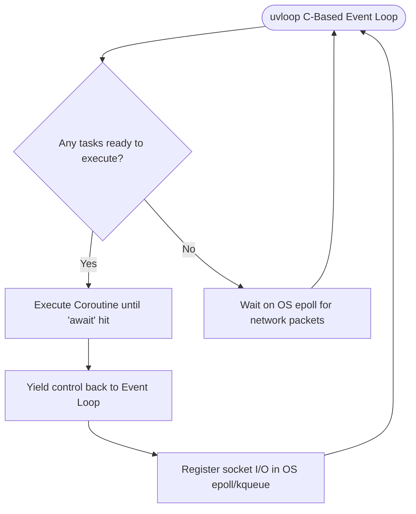

# 01. FastAPI Foundations, ASGI & Asynchronous Python
## The Core Backend Engineer's Masterclass: From Zero to uvloop Internals

> **Instructor's Note:** Whether you are coming from Node.js (Express), Django, or starting fresh: this document teaches you the underlying physics of how FastAPI works under the hood. You will understand Python's event loop, why ASGI crushes WSGI, and how Uvicorn coordinates thousands of non-blocking I/O tasks.

---

## 1. What is FastAPI? (The High-Level Mental Model)

In Node.js Express, you write:
```javascript
app.get('/items', async (req, res) => {
  const items = await db.collection('items').find().toArray();
  res.json(items);
});
```

In FastAPI, you write:
```python
@app.get("/items", response_model=List[ItemResponse])
async def get_items(db: AsyncIOMotorDatabase = Depends(get_database)):
    items = await db.items.find().to_list(length=100)
    return items
```

### The 3 Core Pillars of FastAPI:
1. **Starlette:** Provides the raw, blazingly fast ASGI web routing engine, HTTP connection parsing, websockets, and middleware stack.
2. **Pydantic (v2):** Provides data validation and serialization implemented in **Rust**. It parses incoming JSON, validates types, strips invalid inputs, and serializes Python objects to JSON at C-speed.
3. **Python Type Hints:** FastAPI inspects function signatures (like `name: str, price: float = 0.0`) to automatically generate validation rules and OpenAPI / Swagger documentation.

---

## 2. WSGI vs ASGI: Why Traditional Python Servers Choke

```
+-----------------------------------------------------------------------------------+
| WSGI (Django / Flask / Gunicorn): SYNCHRONOUS THREAD BLOCKING                     |
| Request 1 ----> [ Thread 1: db.query() ........... WAITING (FROZEN) ]             |
| Request 2 ----> [ Thread 2: groq.call() .......... WAITING (FROZEN) ]             |
| Request 3 ----> [ Thread 3: Queued in OS buffer... TIMEOUT 504! ]                 |
+-----------------------------------------------------------------------------------+
| ASGI (FastAPI / Starlette / Uvicorn): ASYNCHRONOUS EVENT LOOP (uvloop)            |
| Request 1 ---\                                                                    |
| Request 2 ------> [ Single Worker Thread: Yields control on 'await' ]             |
| Request 3 ---/    Handles 10,000+ open socket connections concurrently!           |
+-----------------------------------------------------------------------------------+
```

### The Difference in Plain English:
- **In WSGI:** 1 request = 1 OS thread. If your server has 4 worker threads, and 4 users are waiting for a slow database or an external AI call, your entire server is **100% frozen**. Request #5 gets an error.
- **In ASGI:** A single OS thread runs an **event loop** (`uvloop`, written in C). When your code hits `await db.invoices.find_one(...)`, Python suspends that coroutine and lets the event loop process incoming packets for other users. When MongoDB sends back the data, the event loop resumes your coroutine right where it left off.

---

## 3. How the Event Loop Works Under the Hood



### The Golden Rule of Asynchronous Python:
> **NEVER execute a blocking synchronous operation inside an `async def` function!**

If you call `time.sleep(5)` or `requests.get(...)` inside an `async def` endpoint:
- You block the **entire event loop**.
- **Every single user** connected to your server will freeze for 5 seconds.
- **The Fix:** Always use `asyncio.sleep(5)`, `httpx.AsyncClient` instead of `requests`, and Motor instead of PyMongo!

---

## 4. Building the Application Entrypoint: `backend/app/main.py`

Let's dissect how our production server boots up:

```python
# backend/app/main.py
from contextlib import asynccontextmanager
from fastapi import FastAPI
from app.database import init_db, close_db
from app.routers import auth, sites, invoices, importer, dpdp_gateway

@asynccontextmanager
async def lifespan(app: FastAPI):
    # STARTUP: Code here runs BEFORE the server accepts its first request
    print("🚀 Initializing MongoDB Atlas connection pool and indexes...")
    await init_db()
    
    yield # The application runs and handles HTTP traffic here
    
    # SHUTDOWN: Code here runs when the container is stopping
    print("🛑 Closing database connections cleanly...")
    await close_db()

# Create the FastAPI ASGI instance
app = FastAPI(
    title="FrameUp Enterprise MSME OS",
    version="2.4.0",
    lifespan=lifespan
)
```

### Why `lifespan` Replaced `@app.on_event("startup")`:
In modern FastAPI, the `lifespan` context manager ensures that initialization and cleanup happen in a clean, predictable Python generator scope. It guarantees that database connections are gracefully drained before the container terminates.

---

## 5. Mounting Routers with Clean Prefixes & Tags

Instead of dumping 80 endpoints into one giant file, we partition them into modular sub-routers:

```python
# backend/app/main.py
app.include_router(auth.router, prefix="/api/auth", tags=["Authentication"])
app.include_router(sites.router, prefix="/api/sites", tags=["Storefronts"])
app.include_router(invoices.router, prefix="/api/invoices", tags=["GST Billing"])
app.include_router(importer.router, prefix="/api/importer", tags=["AI Data Importer"])
app.include_router(dpdp_gateway.router, prefix="/api/dpdp", tags=["DPDP Act 2023"])
```

- `prefix="/api/invoices"`: Automatically attaches the base path to all routes in that module.
- `tags=["GST Billing"]`: Groups the endpoints into a clean, collapsible section in the interactive `/docs` Swagger UI.
