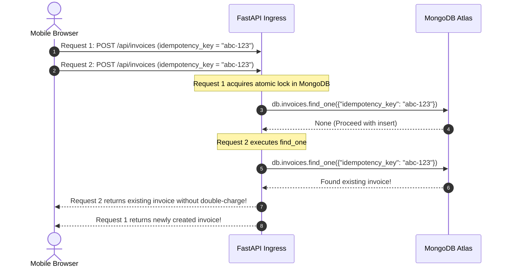

# 07. Background Workers & Concurrency: Non-Blocking Architecture
## The Core Backend Engineer's Masterclass: Background Jobs, Tasks & Queues

> **Instructor's Note:** If an HTTP request takes longer than 500ms to complete, you should never make the client wait synchronously for the entire process. 
> 
> In this guide, you will master FastAPI's native **`BackgroundTasks`**, understand when to choose lightweight background tasks over heavy distributed message queues (Celery/RabbitMQ), and learn how to implement **Idempotency Keys** to prevent race conditions.

---

## 1. When to Use `BackgroundTasks` vs Celery

```
+------------------------------------+-----------------------------------------------+
| Feature Matrix                     | FastAPI BackgroundTasks                       | Celery + Redis / RabbitMQ     |
+------------------------------------+-----------------------------------------------+
| Setup Complexity                   | Zero! Native to FastAPI & asyncio             | High (Needs Redis & workers)  |
| RAM Overhead                       | 0 MB additional RAM                           | 150MB+ per Celery worker      |
| Task Persistence across Crashes    | Volatile (Tasks in RAM lost on crash)         | Persistent (Redis queue disk) |
| Ideal Use Case                     | Audit logging, sending emails, cleanup tasks  | 2-hour video encoding pipelines|
+------------------------------------+-----------------------------------------------+
```

### The Architectural Decision for FrameUp:
For MSME workflows (logging an SHA-256 DPDP audit proof, refreshing a cache, sending a WhatsApp receipt notification), spinning up a separate Celery cluster adds \$30/month in hosting costs and connection complexity.
We use **FastAPI `BackgroundTasks`** running directly as asynchronous coroutines on the Uvicorn event loop:

```python
# backend/app/routers/dpdp_gateway.py
from fastapi import BackgroundTasks

async def async_audit_logger(certificate_id: str, payload: dict):
    """Executes in background AFTER the HTTP response has been sent to client!"""
    await db.audit_logs.insert_one({
        "certificate_id": certificate_id,
        "event": "CONSENT_RECORDED",
        "timestamp": datetime.now(timezone.utc),
        "payload": payload
    })

@router.post("/consent")
async def record_consent(
    payload: ConsentRequest, 
    background_tasks: BackgroundTasks
):
    # 1. Immediate synchronous work: Validate Verhoeff and create certificate
    cert_id = await create_consent_certificate(payload)
    
    # 2. Hand off secondary audit work to background coroutine
    background_tasks.add_task(async_audit_logger, cert_id, payload.dict())
    
    # 3. Return HTTP 201 Created to user in <40ms!
    return {"certificate_id": cert_id, "status": "active"}
```

---

## 2. Preventing Race Conditions with Idempotency Keys

When a user on a mobile 4G connection taps "Submit" twice, the browser dispatches two concurrent HTTP requests:



---

## 3. Circuit Breaker for Upstream Resilience

When calling external APIs (like Groq Cloud), we prevent thread pool starvation by wrapping calls in an asynchronous Circuit Breaker:

```python
# backend/app/services/circuit_breaker.py
import time
from typing import Callable, Any

class CircuitBreaker:
    def __init__(self, failure_threshold: int = 5, recovery_timeout: float = 30.0):
        self.failure_threshold = failure_threshold
        self.recovery_timeout = recovery_timeout
        self.failure_count = 0
        self.last_failure_time = 0.0
        self.state = "CLOSED" # CLOSED, OPEN, HALF-OPEN

    async def call(self, func: Callable, *args, **kwargs) -> Any:
        now = time.time()
        
        # Trip fast if breaker is OPEN
        if self.state == "OPEN":
            if now - self.last_failure_time > self.recovery_timeout:
                self.state = "HALF-OPEN"
            else:
                raise Exception("Circuit breaker is OPEN. Upstream AI is recovering.")
                
        try:
            result = await func(*args, **kwargs)
            if self.state == "HALF-OPEN":
                self.state = "CLOSED"
                self.failure_count = 0
            return result
        except Exception as e:
            self.failure_count += 1
            self.last_failure_time = now
            if self.failure_count >= self.failure_threshold:
                self.state = "OPEN"
            raise e
```
