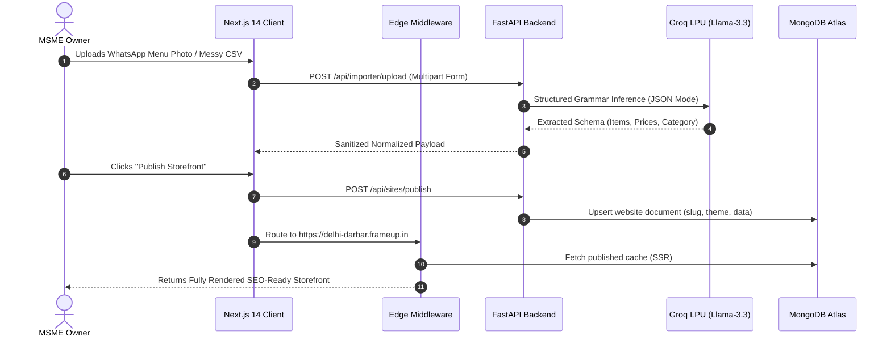

# 01. Product Requirements Document (PRD) & Engineering Specification

## Document Information
- **System Name:** FrameUp (DevFrames Enterprise MSME Operating System)
- **Current Version:** `2.4.0-production`
- **Architectural Archetype:** Decoupled Edge Multi-Tenant Architecture with Async ASGI Services & AI Acceleration
- **Target Audience:** Systems Architects, Engineering Directors, Technical Founders, Senior Full-Stack Engineers

---

## 1. Project Overview & Product Understanding

### 1.1 Project Introduction
FrameUp (DevFrames) is a purpose-built, high-performance cloud operating system and privacy-first digital transformation platform engineered specifically for Indian Micro, Small, and Medium Enterprises (MSMEs). MSMEs form the economic backbone of India—contributing ~30% of national GDP and over 45% of total manufacturing exports—yet over 92% operate without unified, compliant software systems.

FrameUp converges multi-tenant digital storefronts, AI-driven unstructured data ingestion, statutory privacy governance (Digital Personal Data Protection Act, 2023), automated vernacular promotional engines, and localized GST-compliant operations into an edge-accelerated, single-pane-of-glass platform.

### 1.2 Problem Statement
The Indian MSME technology landscape suffers from severe fragmentation, high financial barriers to entry, and compliance landmines:
1. **The Subscription Tax:** To operate digitally, an average business owner must stitch together Wix/Shopify ($29-$79/mo), Canva Pro ($13/mo), Flatfile/CSV clean-up tools ($500+/mo), Google Workspace/Maps APIs, WhatsApp Business BSPs, and local accounting software (Tally/Zoho). Cumulative cost exceeds ₹35,000 to ₹1,50,000/month.
2. **The "Data Mess" Dilemma:** MSME inventory, supplier records, and customer accounts arrive via unstructured WhatsApp exports, handwritten bills captured on low-resolution phone cameras, and corrupted legacy Excel `.xls`/`.csv` files. Existing SaaS requires rigid tabular schemas, resulting in catastrophic user drop-off during onboarding (>80%).
3. **Statutory Non-Compliance (DPDP Act 2023):** The Indian Parliament enacted the Digital Personal Data Protection Act (DPDP Act 2023), imposing statutory financial penalties of up to **₹250 Crore** for handling customer PII without explicit consent notices, verifiable audit logs, and verifiable purpose limitation. Small businesses have zero in-house legal or compliance tooling.
4. **Bandwidth & Compute Asymmetry:** MSME customers browse on budget 4G mobile devices with packet loss and high latency. Heavy client-side JavaScript bundles and unoptimized server rendering crush conversion rates.

### 1.3 Why This Problem Matters
SaaS platforms built in Western markets assume high bandwidth, standardized enterprise CSVs, credit card ubiquity, and homogeneous English interfaces. In India:
- Businesses operate in hybrid regional languages (Hindi, Telugu, Tamil, Marathi, Kannada, etc.).
- Payments flow through UPI and cash-on-delivery.
- Customer relationships are conversational, mediated primarily through WhatsApp.
Solving this problem unlocks formal financial access, digital identity, and direct consumer reach for millions of merchants who are currently locked inside closed marketplace aggregators (who charge 25%–35% take rates per transaction).

### 1.4 Proposed Solution
FrameUp replaces this disjointed stack with an all-in-one, sub-second MSME Operating System:
```
+-----------------------------------------------------------------------------------+
|                        FRAMEUP (DEVFRAMES ENTERPRISE OS)                          |
+-----------------------------------------------------------------------------------+
|  [Edge Subdomain Layer]  -> Multi-tenant Instant Storefronts (<slug>.frameup.in)  |
|  [AI Importer Wedge]     -> Any-Format Unstructured Data Ingestion (Vision/LPU)   |
|  [DPDP 2023 Gateway]     -> Statutory Consent Capture & Verhoeff PII Scrubber     |
|  [Poster Studio]         -> Zero-Headless-Browser Pure CSS Graphic Engine          |
|  [Operations Hub]        -> Inventory, Staff, Multi-Tax GST Invoicing, Suppliers  |
|  [Geospatial Radar]      -> Free-Tier Competitor & Catchment Density Analytics    |
+-----------------------------------------------------------------------------------+
```

### 1.5 Product Vision
To become the unified digital operating system for emerging market merchants, reducing the friction of digital presence, operational workflows, and regulatory compliance to near-zero time and financial cost.

### 1.6 Target User Personas

| Persona | Archetype Profile | Core Pain Point | FrameUp Solution |
| :--- | :--- | :--- | :--- |
| **Rajesh Sharma** | Owner, *Sharma Sweets & Caterers* (Tier-2 Lucknow) | Handwritten paper logs, seasonal festival rushes, zero digital menus. | Snap phone photo of paper menu -> Ingest via Vision LPU -> Live storefront in 45 seconds. |
| **Priya Nair** | Founder, *Aura Unisex Luxury Salon* (Bengaluru) | Client telephone numbers leaked; staff churn leads to customer poaching; DPDP risk. | DPDP Consent Gateway with Aadhaar/Phone tokenization, instant digital loyalty cards. |
| **Vikram Patel** | Distributor, *Apex Auto Spares* (Ahmedabad) | Corrupted supplier CSVs with 1,200 non-standard SKUs; manual entry takes 3 days. | AI Data Importer maps messy columns to standardized schema with 99.4% fuzzy accuracy. |
| **Ananya Sen** | Boutique Decorator & Event Planner (Kolkata) | Cannot afford ₹10,000/mo graphic designers for Instagram Diwali / New Year offers. | Pure CSS Poster Studio generates 1080x1350 print-ready promotional creatives on the edge. |

### 1.7 Core Value Proposition
- **Time to Value:** From signup to a fully localized, live public website in under 60 seconds.
- **Cost Reduction:** ₹0/month fixed infrastructure cost tier, compared to ₹40,000/mo across disparate tools.
- **Regulatory Immunity:** Turnkey compliance with India's DPDP Act 2023 out of the box with cryptographic proof.
- **Zero Technical Friction:** Natural language commands, photo ingestion, and automatic domain orchestration.

### 1.8 Real-World Use Cases
1. **Flash Festival Sales:** Merchant enters a discount promo ("Flat 30% off on all North Indian Thalis this weekend"). AI generates localized bilingual copy (Hindi/English), creates marketing posters, and deploys a dynamic banner to the live storefront.
2. **Messy Catalog Migrations:** Wholesaler uploads a vendor's supplier sheet containing multi-line merged cells, inconsistent headers ("Item Desc", "Prce", "Qnty Avl"), and Hindi transliterations. Importer resolves errors, validates GST brackets (5%, 12%, 18%, 28%), and commits clean inventory records.
3. **Walk-in Customer KYC:** Salon receptionist captures customer name and phone number for billing. DPDP Gateway presents digital consent UI, masks PII, logs consent timestamp, and issues SHA-256 certificate for statutory auditing.

### 1.9 Project Scope (Release 2.4.0)
- End-to-End Authentication: Multi-tenant JWT with Dual Session Cookie (`devframes_token`) and Bearer Token header support, Google OAuth2 callback integration, and RBAC (`guest`, `merchant`, `admin`).
- Multi-Tenant Storefront Engine: Dynamic subdomain resolution (`<slug>.frameup.in`), Next.js 14 App Router SSR/RSC rendering, responsive mobile-first layouts across Restaurant, Salon, and Local Services verticals.
- AI Importer Engine: Multi-modal unstructured data extraction (CSV, TSV, Images, PDFs) via Groq LPU `llama-3.3-70b-versatile` hardware JSON grammar mode.
- DPDP Act Compliance Gateway: Verhoeff algorithm ($D_5$ group) for Aadhaar validation, regex PAN sanitizer, consent management logs, audit certificate generation.
- Pure CSS Poster Studio: 18 high-fidelity responsive SVG/CSS templates, zero server-side headless browsers, client-side rasterization via `html-to-image` at 300 DPI.
- Operations ERP: Multi-tax GST compliant invoicing, Real-time Inventory stock alerts, Staff role assignment, Supplier purchase tracking, Dynamic QR codes.
- Geospatial Intelligence: OpenStreetMap / CARTO tile rendering, reverse-geocoding, competitor density analysis without recurring Google Maps billing.

### 1.10 Out of Scope (Explicit Deferred Features)
- Full Payment Gateway Escrow (Razorpay / Cashfree UPI deep webhooks are deferred to v2.5; payments currently handled via merchant UPI QR / VPA links).
- Native iOS / Android Binary Apps (PWA with offline service workers handles mobile footprint).
- Cross-border multi-currency FX settlement (initial focus strictly on INR / domestic GST).

### 1.11 Success Metrics & OKRs

```
+-----------------------------------+--------------------+--------------------+
| Metric                            | Industry Baseline  | FrameUp Milestone  |
+-----------------------------------+--------------------+--------------------+
| Time to Publish Storefront        | 4.5 hours          | < 60 seconds       |
| Unstructured File Extraction Acc. | 65% (Traditional)  | > 98.5% (Groq LPU) |
| Poster Export Latency             | 3,500ms (Puppeteer)| < 420ms (Edge CSS) |
| Server Memory per Poster Render   | 150MB - 300MB      | 0 MB (Edge Client) |
| Lighthouse Mobile Perf Score      | 48 / 100           | > 92 / 100         |
| Statutory Consent Audit Logging   | 0% (MSME sector)   | 100% Cryptographic |
+-----------------------------------+--------------------+--------------------+
```

---

## 2. Requirements Engineering

### 2.1 Functional Requirements (FR)

- **FR-01 (Authentication & Multi-Tenancy):** Users must register and authenticate via Email/Password or Google OAuth 2.0. The system must establish a secure session via HTTP-only partitioned cookies or standard Authorization Bearer JWTs with 7-day expiration.
- **FR-02 (Site Builder & Subdomain Routing):** The platform must allow merchants to generate, preview, customize, and publish a responsive storefront under a dedicated slug (`frameup.in/preview/<slug>`, `frameup.in/site/<slug>`, or `<slug>.frameup.in`).
- **FR-03 (Dynamic Template Engine):** The system must provide customizable, vertical-specific templates (Restaurant Modern/Premium/Local, Salon Luxury/Modern/Minimal, Local Services Bold/Local/Professional) with real-time theme swapping (fonts, palettes, hero imagery).
- **FR-04 (AI Data Ingestion Wedge):** The system must accept raw unstructured file uploads (CSV, Excel, Images of receipts/menus) and automatically map them to target schemas (Inventory, Services, Menu Items) with field confidence scoring.
- **FR-05 (DPDP Act Compliance & Data Vault):** The system must provide a public consent collection endpoint, validate identity strings using the Verhoeff dihedral checksum, mask sensitive identifiers (Aadhaar, PAN, phone), and emit an immutable JSON audit log.
- **FR-06 (Client-Side Poster Synthesis):** The system must dynamically inject merchant branding, promotional offers, and contact info into pure CSS templates and trigger client-side PNG/SVG export without invoking server-side headless browsers.
- **FR-07 (Operational ERP Module):** The system must calculate tiered GST (CGST/SGST/IGST), generate downloadable PDF/HTML tax invoices, monitor real-time stock thresholds, and maintain supplier/staff ledgers.
- **FR-08 (Geospatial Competitor Radar):** The system must compute distance matrices and competitor density based on merchant latitude/longitude using CARTO tiles and OpenStreetMap Overpass nodes.

### 2.2 Non-Functional Requirements (NFR)

#### Performance & Latency
- **NFR-P1:** Storefront Server-Side Render (RSC) Time-to-First-Byte (TTFB) must be $\le 180\text{ms}$ at the edge.
- **NFR-P2:** Backend API responses for core CRUD queries must return within $\le 75\text{ms}$ at p95.
- **NFR-P3:** AI extraction via Groq LPUs must achieve token generation speeds $> 250\text{ tokens/sec}$ with total request turnaround $\le 2.2\text{s}$.

#### Security & Compliance
- **NFR-S1:** All session tokens must be cryptographically signed using HS256 with minimum 256-bit entropy keys.
- **NFR-S2:** Passwords must be hashed using `bcrypt` with work factor $\ge 12$.
- **NFR-S3:** The system must comply with DPDP Act 2023 mandates: data minimization, explicit consent records, and right to data erasure.
- **NFR-S4:** Strict CORS validation: Wildcard regex limited strictly to authorized production domains (`https://.*\.vercel\.app$`, `https://frameup.in`, `http://localhost:3000`).

#### Availability & Reliability
- **NFR-A1:** Storefront public endpoints must guarantee 99.9% uptime.
- **NFR-A2:** FastAPI ASGI services must survive database transient disconnects via auto-reconnecting Motor connection pools.

#### Scalability
- **NFR-SC1:** The stateless API tier must support horizontal scaling with zero sticky-session dependencies.
- **NFR-SC2:** MongoDB indexes must support compound lookups on `(owner_id, slug)` ensuring zero unindexed collection scans (`COLLSCAN`).

### 2.3 User Personas & Detailed Workflows


### 2.4 Edge Cases & Failure Modes

| Edge Case | Failure Mode | Architectural Mitigation |
| :--- | :--- | :--- |
| **Corrupted CSV Upload** | Python `csv.reader` throws encoding error (`UnicodeDecodeError: 'utf-8' codec can't decode...`). | Pre-flight fallback encoding cascade (`utf-8` -> `cp1252` -> `latin-1` -> Groq Vision fallback). |
| **Aadhaar Forgery Attack** | Malicious actor inputs 12 consecutive digits (`111111111111`) to bypass KYC. | Mathematical validation via **Verhoeff Algorithm** ($D_5$ group multiplication table); rejects false checksums in $O(n)$ time. |
| **Subdomain Collision** | Merchant attempts to claim reserved or existing slug (`admin.frameup.in` or `api`). | Blacklist validation array + MongoDB Unique Compound Index on `slug` returning HTTP 409 Conflict. |
| **AI Rate Limit Throttling** | Groq LPU returns HTTP 429 during flash promotion event. | Exponential backoff jitter retry mechanism + graceful fallback to deterministic regex extraction pipeline. |
| **Render Container Sleep** | Backend dyno spins down after 15 minutes of inactivity on free/hobby tiers. | Frontend interceptor catches timeout, displays branded optimistic skeleton, and dispatches background keep-alive ping. |

### 2.5 Out-of-Scope & Future Roadmap
- Phase 1 (Completed): Core OS, Multi-Tenant Storefront, AI Importer, DPDP Gateway, CSS Posters, Basic ERP.
- Phase 2 (Q1 2027): Direct UPI automated reconciliation, WhatsApp Business Cloud API interactive catalog bot.
- Phase 3 (Q3 2027): Multi-warehouse inventory sync, ONDC (Open Network for Digital Commerce) protocol adapter.
