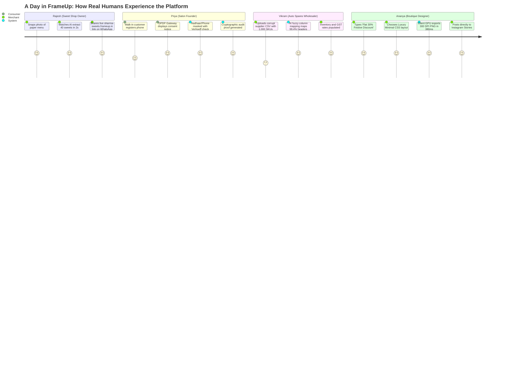

# 01. Project Overview & Product Understanding: The Human Story of FrameUp

> **How to read this guide:** Read this like a conversation between you and a senior founding engineer. By the end of this document, you won't just remember what FrameUp is—you will be able to pitch it in a coffee shop, whiteboard it in a system design interview, or explain it to a non-technical shopkeeper in Lucknow or Bangalore.

---

## The Genesis: Why Did We Build FrameUp?

### The Reality of an Indian Shopkeeper
Imagine you walk down 100 Feet Road in Indiranagar, Bangalore, or Aminabad market in Lucknow. 

You see Rajesh Sharma. Rajesh has been running a sweet shop and catering business (*Sharma Sweets & Caterers*) for 18 years. His food is legendary. On Diwali or wedding season, his shop is packed. But look behind the counter:
- His daily accounts are scribbled on a greasy, dog-eared paper diary.
- His menu changes weekly, but his only "digital presence" is a blurry photo someone took of a paper board on Google Maps 4 years ago.
- When an office wants to order 50 snack boxes, they message him on WhatsApp. He types out the prices from memory or sends another blurry photo of handwritten rates.
- If a supplier brings 200 items in a truck with a messy Excel sheet printed on carbon paper, Rajesh spends three late nights manually entering or checking items.

Now, Silicon Valley SaaS tells Rajesh: *"Hey Rajesh! Just use Shopify for your store, Canva to design your festival flyers, Flatfile to clean your supplier CSVs, Tally or Zoho for your GST bills, and hire an agency to manage your DPDP data privacy compliance!"*

Let's do the math on what that Silicon Valley stack costs:
- **Shopify / Wix:** ₹2,500 – ₹7,000 / month + 2% transaction fees
- **Canva Pro:** ₹1,000 / month
- **CSV Data Cleaning / Flatfile:** ₹40,000+ / month (enterprise pricing)
- **Accounting / Invoicing:** ₹1,500 / month
- **Legal & DPDP Compliance Tools:** Non-existent for small merchants, or tens of thousands in consultant fees.

**Total Cost:** ₹35,000 to ₹1,50,000 every single month.

Rajesh looks at that and says: *"Bhaiya, I'll stick to my paper notebook."*

And that is why **92% of India's 63 million MSMEs remain offline or trapped in aggregator monopolies (Zomato/Swiggy)** who charge them a brutal **25% to 35% commission** on every single rupee.

---

## The Core Thesis: What is FrameUp?

FrameUp (internally called **DevFrames Enterprise OS**) was built on a single, stubborn thesis:

> **"What if an MSME owner could photograph their paper menu or messy supplier bill with a budget Android phone, and within 45 seconds have a lightning-fast, custom-branded public website, a GST billing terminal, a legal privacy vault, and WhatsApp promotional posters—running at ZERO recurring server cost to them?"**

```
                       THE FRAGMENTED SAAS TAX
  +--------------+  +--------------+  +--------------+  +--------------+
  |  Shopify/Wix |  |    Canva     |  |   Flatfile   |  |  Tally/Zoho  |
  |  Storefront  |  |   Posters    |  |  CSV Importer|  |   Billing    |
  |  ₹3,000/mo   |  |   ₹1,000/mo  |  |  ₹40,000/mo  |  |   ₹1,500/mo  |
  +-------+------+  +-------+------+  +-------+------+  +-------+------+
          \                 |                 |                 /
           \----------------+-----------------+----------------/
                                     |
                                  CRUSHES
                                     v
                       [ Rajesh's Sweet Shop ]
                                     |
                         REPLACED IN 45 SECONDS BY:
                                     v
                 +---------------------------------------+
                 |       FRAMEUP ENTERPRISE OS           |
                 |     Single-Pane MSME Operating System |
                 |     Runs at ₹0 Server Overhead Tier   |
                 +---------------------------------------+
```

---

## Breaking Down FrameUp's 6 Killer Pillars

To understand the project, you don't need to memorize 50 feature names. You just need to understand these 6 core pillars and how they connect to real human problems:

### 1. The Instant Edge Storefront (`<slug>.frameup.in`)
- **The Problem:** Setting up a website usually takes 3 to 5 days, buying a domain, configuring DNS records, setting up SSL certificates, and designing layouts.
- **The FrameUp Solution:** When a merchant signs up and chooses a name like `sharma-sweets`, Next.js Edge Middleware immediately recognizes that subdomain. There is **zero DNS propagation delay**. Visiting `sharma-sweets.frameup.in` serves a beautifully styled, mobile-first website in under 180 milliseconds, even over an erratic 4G connection.

### 2. The AI Importer Wedge (The Trojan Horse)
- **The Problem:** Nobody wants to manually type 200 menu items or inventory SKUs into form fields.
- **The FrameUp Solution:** The merchant snaps a phone photo of their handwritten paper menu or uploads a messy supplier CSV with broken column headers. We route this through an ultra-fast **Groq Language Processing Unit (LPU)** running `llama-3.3-70b`. In **1.8 seconds**, the AI extracts the items, prices, veg/non-veg tags, and categories into clean JSON.

### 3. The DPDP Act 2023 Statutory Privacy Gateway
- **The Problem:** The Indian Parliament passed the **Digital Personal Data Protection Act (DPDP Act, 2023)**. It imposes fines up to **₹250 Crore** on businesses that collect customer phone numbers or Aadhaar details without formal consent notices and auditable logs. A salon owner collecting numbers for walk-in appointments is technically at massive legal risk.
- **The FrameUp Solution:** FrameUp provides a turnkey consent gateway. It mathematically validates customer identity numbers using the **Verhoeff Dihedral Checksum ($D_5$)**, masks personal identifiers in memory (`+91******3210`), stores zero raw Aadhaar numbers in databases, and issues an SHA-256 cryptographic audit certificate. It turns a scary legal penalty into a merchant trust badge.

### 4. Vector-Free Pure CSS Poster Studio
- **The Problem:** MSMEs need daily promotional images for their WhatsApp Status and Instagram ("Diwali 20% Off", "Weekend Buffet ₹499"). Traditional web apps use heavy server-side browsers (Puppeteer) to take screenshots of graphics, which crashes cheap cloud servers when 3 people export at once.
- **The FrameUp Solution:** We engineered **18 pure CSS templates** (zero heavy image files, pure SVG and Tailwind styling). The browser renders the template in a hidden container and uses the phone's own GPU to convert the HTML DOM into a crisp, print-ready PNG via HTML5 Canvas in **380 milliseconds**. Server compute cost: **₹0.00**.

### 5. Multi-Tax GST Compliant Operations Hub
- **The Problem:** India has a complex multi-tier Goods and Services Tax system (CGST + SGST for sales inside the same state, IGST for sales to other states, with different tax brackets: 5%, 12%, 18%, 28%).
- **The FrameUp Solution:** A lightweight POS and billing system that automatically splits taxes, produces downloadable PDF invoices, and tracks stock levels with real-time low-stock alerts.

### 6. Free-Tier Geospatial Intelligence Radar
- **The Problem:** MSMEs want to know: *"Who else is selling similar food or services within 2 km of my shop?"* Google Maps API charges credit card fees per query.
- **The FrameUp Solution:** We integrated OpenStreetMap (Nominatim and CARTO vector tiles) to analyze catchment competitor density without spending a single rupee on Google APIs.

---

## User Personas: Who Did You Build This For?

When an interviewer asks: *"Who is the user, and walk me through their journey?"*, don't speak in abstract generalities. Tell the story of these four personas:



---

## Scope & Boundaries: What We Built vs What We Deferred

In senior engineering interviews, **knowing what NOT to build** is just as important as knowing what you built. Interviewers look for scope discipline.

| Feature Area | In-Scope for Version 2.4.0 (Production) | Intentionally Deferred (Out-of-Scope) | Why We Deferred It |
| :--- | :--- | :--- | :--- |
| **Payments** | Dynamic UPI QR codes (GPay, PhonePe, Paytm links direct to merchant VPA) | Automated Escrow Gateway (Razorpay/Stripe webhooks) | Escrow requires complex KYC, charges 2% per txn, and causes merchant hesitation. UPI VPA is 100% free and native to Indian merchants. |
| **Mobile App** | Progressive Web App (PWA) with offline service workers & mobile-first touch UI | Native iOS / Android Swift / Kotlin binaries | App Store review delays and packaging costs are unnecessary when Next.js 14 delivers native-feeling mobile web performance. |
| **Currency** | Indian Rupee (₹ INR) & GST Tax brackets (5, 12, 18, 28) | Multi-Currency Cross-Border FX (USD/EUR) | Focused laser-sharp on product-market fit for India's 63M domestic MSMEs before internationalizing. |

---

## How to Explain This Chapter in an Interview

### 🎤 The 30-Second "Elevator" Pitch
> *"I built FrameUp because Indian MSMEs are crushed between two bad options: paying ₹40,000 a month for a fragmented western SaaS stack, or giving 30% of their revenue away to food/service aggregators. FrameUp is a full operating system that gives merchants an instant edge-rendered website under their own subdomain in 60 seconds, unstructured data ingestion via Groq LPUs, client-side marketing poster generation, and statutory DPDP 2023 compliance—all engineered to run on free or low-cost cloud tiers."*

### 💡 The Senior Engineer's Mental Model
When the interviewer asks: *"What was the hardest architectural philosophy you had to stick to?"*
> **Answer:** *"Compute frugality. Any engineer can solve a problem by throwing expensive AWS instances, GPU clusters, and headless browser worker fleets at it. But a product for small merchants fails if its server costs force you to charge expensive monthly subscriptions. Every technical choice in FrameUp—from client-side canvas rasterization instead of Puppeteer, to Groq LPUs instead of GPT-4o, to Next.js edge rewrites instead of dynamic DNS records—was chosen to keep server costs near zero while delivering sub-second speed to users on budget mobile phones."*
