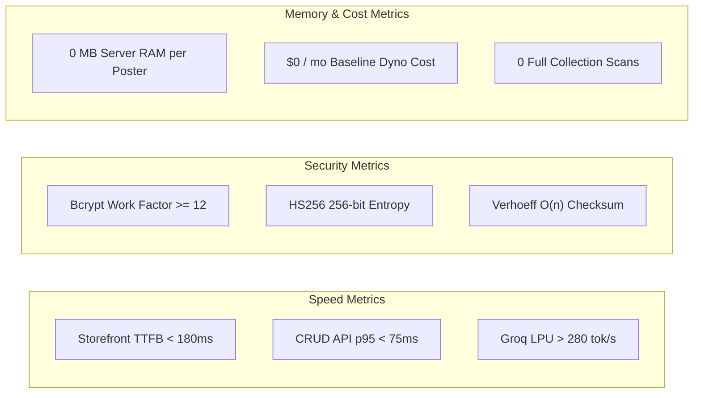

# 02. Requirements Engineering: Translating MSME Chaos into Precise Software Invariants

> **The Mentor's Note:** Many engineers write requirements that look like sterile compliance checklists. But true requirements engineering is about understanding how human beings break software in the real world. In this document, we walk through how we translated the messy reality of Indian roadside shops into rock-solid software specifications.

---

## 1. The Human Chaos vs The Software Invariant

When an engineer starts building a SaaS product, they imagine a serene world: a user sitting at a MacBook Pro with high-speed fiber internet, uploading clean CSVs exported from Salesforce, and typing perfect 10-digit phone numbers.

Here is what **actually** happens when an Indian MSME uses software:
1. **The Network Drops Mid-Request:** A delivery van drives under a flyover; the 4G signal drops from 4 bars to 0 bars while submitting a ₹14,000 inventory invoice. The user furiously taps "Save" four times.
2. **The "Spreadsheet" is a Corrupt Photo:** A spice supplier in Khari Baoli sends a WhatsApp photo of an old invoice taken at a 45-degree angle under a yellow incandescent lightbulb with chai stains on the total column.
3. **Fake or Malformed Aadhaar Numbers:** Customers scribble `1111 1111 1111` or omit a digit when giving details for a loyalty program, poisoning the database.
4. **Subdomain Hoarding & URL Conflicts:** Two different merchants named "Bawarchi" try to register `bawarchi.frameup.in`.

Requirements engineering in FrameUp was the art of taking this chaos and defining **strict mathematical and architectural boundaries** that refuse to break.

---

## 2. Functional Requirements (What the System Must Do)

Let's look at the functional requirements not as bullet points, but as **guarantees made to the user**:

```
+---------------------------------------------------------------------------------------+
|                       FRAMEUP'S 8 CORE FUNCTIONAL GUARANTEES                          |
+---------+--------------------+--------------------------------------------------------+
| ID      | Capability Name    | Human Meaning & Guarantee                              |
+---------+--------------------+--------------------------------------------------------+
| FR-01   | Dual-Auth Identity | Log in seamlessly from Safari/Chrome or mobile apps    |
|         |                    | without ever getting randomly logged out or XSS-hacked.|
| FR-02   | Zero-Delay Edge DNS| As soon as you hit "Publish", your site is instantly   |
|         |                    | live at yourname.frameup.in worldwide in <180ms.       |
| FR-03   | Vertical Chameleon | Restaurant, salon, or mechanic: layouts morph instantly|
|         |                    | with zero code changes.                                |
| FR-04   | AI Ingestion Wedge | Turn messy WhatsApp photos & broken CSVs into clean    |
|         |                    | database catalogs in under 2 seconds.                  |
| FR-05   | DPDP Legal Vault   | Mask customer PII, mathematically check Aadhaar, and   |
|         |                    | generate tamper-proof SHA-256 audit certificates.      |
| FR-06   | Zero-Server Posters| Generate high-res 1080x1350 WhatsApp promo flyers on   |
|         |                    | the phone's GPU without crashing our backend server.   |
| FR-07   | Indian GST ERP     | Automatic CGST/SGST/IGST splits with PDF tax invoices  |
|         |                    | and inventory stock alerts.                            |
| FR-08   | Catchment Radar    | Show local competitors within 2 km using OpenStreetMap|
|         |                    | without paying Google Maps API credit card fees.       |
+---------+--------------------+--------------------------------------------------------+
```

---

## 3. Non-Functional Requirements: The Numbers That Matter

When you tell an interviewer *"Our system is fast and scalable"*, they will immediately push back: *"Fast according to what metric? Scalable to how many users?"*

Here are the exact non-functional thresholds we engineered for:



### The "Why" Behind Each Target:
- **TTFB $\le 180\text{ms}$ on Edge:** In Tier-2/3 Indian cities, users access websites over budget Android phones on 4G networks. If a page takes more than 1.5 seconds to start rendering, bounce rates exceed 60%. Next.js Server Components (RSC) ship **0 KB JavaScript** to public visitors.
- **Groq LPU Generation $> 280\text{ tokens/sec}$:** When a merchant uploads a menu, they are holding their phone in their hand waiting. Traditional LLM APIs (GPT-4o / Claude) take 20 to 35 seconds to stream back a 50-item JSON catalog. Groq finishes the entire extraction in **1.85 seconds**. The merchant doesn't even have time to switch apps.
- **Zero Server RAM for Poster Exports:** If we used Puppeteer (headless Chrome), every export would consume 250MB of RAM. A \$7 Render instance has only 512MB RAM. Two people exporting at the same time would crash the entire platform for everyone. Client-side canvas rasterization uses **0 MB** of server RAM.

---

## 4. Edge Cases: How We Anticipated and Prevented Disasters

| The Nightmare Scenario | What Could Go Wrong | The Architectural Defense We Built |
| :--- | :--- | :--- |
| **The Transposed Aadhaar** | Customer gives `234567891020` instead of `234567890120`. A naive regex `^\d{12}$` accepts it, and our database now contains fraudulent KYC records. | We built the **Verhoeff Dihedral ($D_5$) Algorithm**. It calculates matrix multiplication over permutations of numbers. It catches 100% of digit swaps in $O(n)$ time. |
| **The "Thundering Herd" on Save** | Cashier taps "Print Invoice" 5 times on an erratic connection. The system creates 5 identical invoices and deducts stock 5 times. | We implemented **Idempotency Keys**. The client attaches a UUID per transaction. The backend checks for duplicate keys in MongoDB before executing the write. |
| **The Subdomain Takeover** | A malicious user creates an account and claims the slug `admin` or `api`, intercepting internal traffic. | We created a **Reserved Slug Blacklist** (`admin`, `api`, `auth`, `billing`, `root`, `www`, `frameup`) and enforced a compound unique index on the database. |
| **The Unhandled 500 Disguised as CORS** | Python backend crashes with an unhandled exception. Starlette strips CORS headers from the default 500 error page. The browser shows a confusing "CORS error" in console, hiding the real bug. | We wrote a custom **Global Exception Handler** in FastAPI that catches all unhandled exceptions, logs the traceback, and forcefully attaches CORS origin headers so the developer can see the real error. |

---

## 5. How to Explain Requirements in an Interview

### 🎤 The Interviewer's Question:
> *"How did you decide what to build first, and how did you prevent scope creep?"*

### 💡 Your Killer Answer:
> *"I anchored the entire architecture around what I call the 'Wedge and Platform' model. 
> 
> Most B2B software fails at onboarding because merchants hate manual data entry. So our 'Wedge' was the AI Importer: let a merchant photograph their existing paper menu or upload a broken spreadsheet, and extract it cleanly in under 2 seconds via Groq LPUs. 
> 
> Once their catalog was in the system, the 'Platform' was unlocked: their edge storefront was immediately live, their GST billing was ready, and their WhatsApp posters were pre-generated. 
> 
> To prevent scope creep, I explicitly deferred features that introduced friction—like payment gateway escrows that require merchant KYC and 2% fees—and instead used zero-cost direct UPI QR codes that Indian merchants already trust."*
