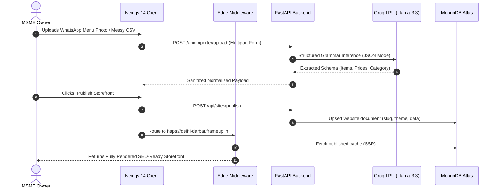

# 02. Requirements Engineering

## 2. Requirements Engineering & Specifications

### 2.1 Functional Requirements (FR)

- **FR-01 (Authentication & Tenant Isolation):** The system must authenticate users via Email/Password (Bcrypt hashed) or Google OAuth2. The system must establish a secure session via partitioned HTTP-Only cookies (`devframes_token`) or standard Bearer JWTs, scoping all operational database records strictly to the logged-in user (`owner_id`).
- **FR-02 (Multi-Tenant Edge Subdomain Routing):** The platform must dynamically resolve merchant slugs (`<slug>.frameup.in`) and rewrite paths to `/site/[slug]` at the edge without requiring manual DNS records or container restarts.
- **FR-03 (Vertical-Specific Dynamic Storefronts):** The system must provide customizable, responsive templates across core Indian verticals (Restaurant Modern/Premium/Local, Salon Luxury/Modern/Minimal, Local Services Bold/Local/Professional) with real-time theme swapping (fonts, palettes, hero imagery).
- **FR-04 (Multi-Modal AI Data Importer Wedge):** The system must accept raw, unstructured file uploads (CSV, TSV, phone photos of menus, receipts, PDFs) and automatically map them to target schemas (Inventory, Services, Menu Items) with confidence scores $\ge 0.95$.
- **FR-05 (Statutory DPDP Act 2023 Consent Gateway):** The system must capture explicit user consent, validate 12-digit Aadhaar identifiers using the **Verhoeff Dihedral Checksum ($D_5$)**, mask telephone and identity numbers in persistent storage, and emit tamper-evident SHA-256 audit certificates.
- **FR-06 (Zero-Headless-Browser Poster Synthesis):** The system must inject merchant branding and discount offers into 18 pure CSS templates and trigger client-side PNG/SVG export via HTML5 Canvas (`html-to-image`) at 300 DPI without invoking server-side headless browsers.
- **FR-07 (GST Tax Invoicing & ERP Ledgers):** The system must calculate multi-tier Indian GST (intra-state CGST+SGST, inter-state IGST), generate printable HTML/PDF tax invoices, maintain real-time stock thresholds, and track staff and supplier ledgers.
- **FR-08 (Geospatial Catchment & Competitor Radar):** The system must reverse-geocode merchant coordinates and compute catchment density using CARTO tiles and OpenStreetMap Overpass nodes.

---

### 2.2 Non-Functional Requirements (NFR)

#### Performance & Latency
- **NFR-P1 (Edge TTFB):** Storefront Server-Side Render (RSC) Time-to-First-Byte must be $\le 180\text{ms}$ globally.
- **NFR-P2 (API Latency):** Backend API responses for core CRUD queries must return within $\le 75\text{ms}$ at p95.
- **NFR-P3 (AI Velocity):** AI extraction via Groq LPUs must achieve token generation speeds $> 250\text{ tokens/sec}$ with total request turnaround $\le 2.2\text{s}$.

#### Security & Compliance
- **NFR-S1 (Cryptographic Signatures):** All session tokens must be signed using HS256 with 256-bit entropy keys.
- **NFR-S2 (Credential Storage):** Passwords must be hashed using `bcrypt` with work factor $\ge 12$.
- **NFR-S3 (DPDP Minimization):** Personal identifiers must never be stored in plaintext. Raw Aadhaar numbers must be rejected from persistent databases.
- **NFR-S4 (CORS Hardening):** Wildcard regex limited strictly to authorized production domains (`https://.*\.vercel\.app$`, `https://frameup.in`, `http://localhost:3000`).

#### Availability & Reliability
- **NFR-A1 (Storefront Uptime):** Public edge storefronts must achieve $\ge 99.9\%$ availability.
- **NFR-A2 (Connection Resilience):** FastAPI ASGI services must survive database transient disconnects via auto-reconnecting Motor connection pools.

#### Scalability
- **NFR-SC1 (Stateless Architecture):** The API tier must be 100% stateless with zero sticky-session dependencies.
- **NFR-SC2 (Zero Full Collection Scans):** All database read paths must be backed by compound indexes (`IXSCAN`).

---

### 2.3 User Personas & Workflows

---

### 2.4 Edge Cases & Failure Modes

| Edge Case | Failure Mode | Architectural Mitigation |
| :--- | :--- | :--- |
| **Corrupted CSV Upload** | Python `csv.reader` throws encoding error (`UnicodeDecodeError: 'utf-8' codec can't decode...`). | Pre-flight fallback encoding cascade (`utf-8` -> `cp1252` -> `latin-1` -> Groq Vision fallback). |
| **Aadhaar Forgery Attack** | Malicious actor inputs 12 consecutive digits (`111111111111`) to bypass KYC. | Mathematical validation via **Verhoeff Algorithm** ($D_5$ group multiplication table); rejects false checksums in $O(n)$ time. |
| **Subdomain Collision** | Merchant attempts to claim reserved or existing slug (`admin.frameup.in` or `api`). | Blacklist validation array + MongoDB Unique Compound Index on `slug` returning HTTP 409 Conflict. |
| **AI Rate Limit Throttling** | Groq LPU returns HTTP 429 during flash promotion event. | Exponential backoff jitter retry mechanism + graceful fallback to deterministic regex extraction pipeline. |
| **Render Container Sleep** | Backend dyno spins down after 15 minutes of inactivity on free/hobby tiers. | Frontend interceptor catches timeout, displays branded optimistic skeleton, and dispatches background keep-alive ping. |

---

### 2.5 Constraints & Assumptions
- **Connectivity:** Designed for erratic 4G mobile data connections with high packet drop rates.
- **Client Devices:** Optimized for low-end Android smartphones (2GB–4GB RAM, Chromium-based browsers).
- **Statutory Framework:** Aligned strictly with the Digital Personal Data Protection Act, 2023 (Ministry of Electronics and Information Technology, Government of India).
