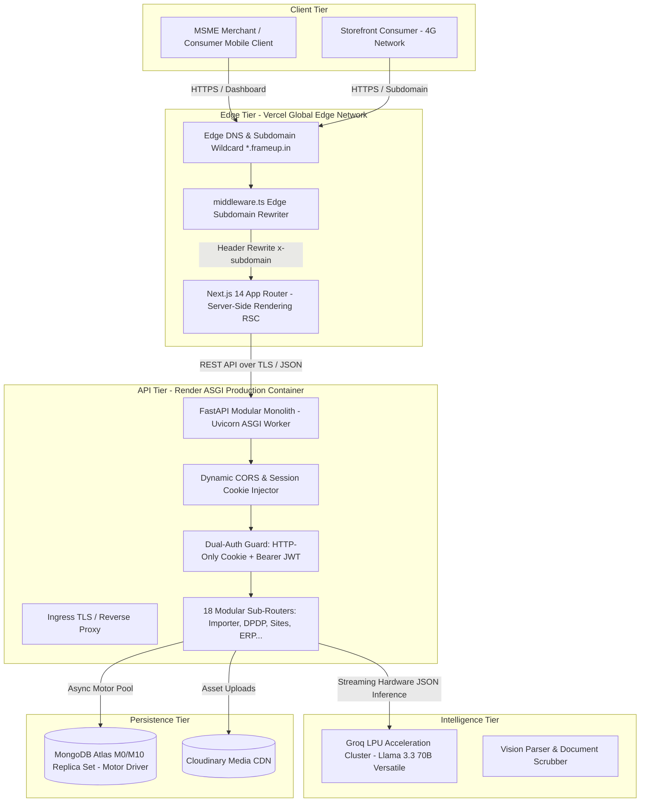
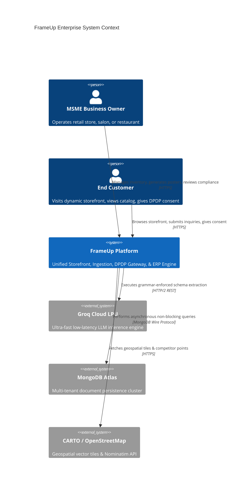
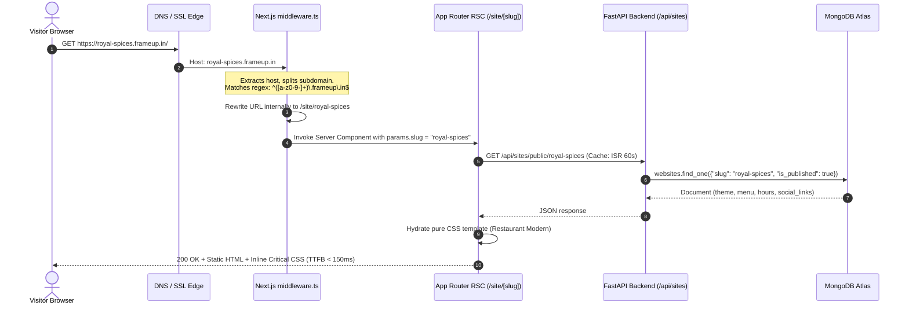

# 02. System Architecture & Engineering Technology Stack

## Document Information
- **System:** FrameUp Distributed Production Architecture
- **Layer:** Edge CDN, App Router (Next.js 14), ASGI Monolith (FastAPI), Async Worker Layer (AtlasOS), NoSQL Storage (MongoDB Atlas)
- **Deployment Status:** Production

---

## 3. System Architecture & Topologies

### 3.1 Architecture Style
FrameUp employs a **Decoupled Edge-Accelerated Micro-Monolith Architecture**. Rather than decomposing prematurely into distributed microservices with heavy gRPC network serialization costs and distributed transaction overhead (Two-Phase Commit / Saga orchestrators), FrameUp consolidates business capabilities into a modular, asynchronous FastAPI Python ASGI core, bridged with an ultra-low latency Next.js 14 App Router deployed at the Vercel Edge.

### 3.2 High-Level System Architecture (C4 Level 1 & 2)

#### C4 Context (Level 1)

### 3.3 Edge Subdomain Routing Architecture
One of the core architectural differentiators of FrameUp is its **zero-configuration instant multi-tenant storefront**. When a merchant registers a slug (e.g. `royal-spices`), the public site immediately becomes accessible at both `https://frameup.in/site/royal-spices` and `https://royal-spices.frameup.in`.

### 3.4 Data Flow Architecture

#### Write Pipeline (Transactional & Event-Driven)
1. Ingestion of raw payloads into FastAPI controller via Pydantic model validation.
2. Async context manager resolves MongoDB collection handle from Motor client pool.
3. Transactional validation enforces uniqueness and DPDP PII redacting rules.
4. Storage written to MongoDB with write concern `w: "majority"`.
5. Background notification / audit log dispatched via `atlasos` lightweight worker queue.

#### Read Pipeline (Edge-Cached & Query Optimized)
1. Read requests hit Next.js 14 Server Components.
2. Public storefront requests utilize `fetch(..., { next: { revalidate: 60 } })` for Incremental Static Regeneration (ISR).
3. Private dashboard queries pass through authenticated reverse proxy route handlers, attaching HttpOnly session tokens.
4. Database reads utilize compound indexes `(owner_id: 1, created_at: -1)`, yielding single-digit millisecond index scans (`IXSCAN`).

### 3.5 Asynchronous & Background Processing
For heavy I/O operations (e.g., bulk importer batch verification, DPDP cryptographic certificate hashing, and multi-resolution poster asset generation), processing is handed off to background tasks via `FastAPI.BackgroundTasks` and AtlasOS async jobs, preventing worker thread starvation on the Uvicorn event loop.

---

## 4. Technology Stack & Engineering Decisions

### 4.1 Technology Stack Matrix

| Layer | Technology | Version | Rationale & Selection Criteria |
| :--- | :--- | :--- | :--- |
| **Frontend Framework** | Next.js (React) | `14.2.5` | Native Server Components (RSC), Edge Middleware URL rewrites, and built-in image optimization. |
| **Client Styling** | Tailwind CSS + Lucide Icons | `3.4.1` | Zero-runtime CSS compilation, purge unused styles, consistent design token system. |
| **Edge Rasterization** | `html-to-image` | `1.11.11` | Pure browser SVG/Canvas DOM rendering; eliminates server-side Chromium/Puppeteer dependencies. |
| **Backend Framework** | FastAPI (Python) | `0.111.0` | High-throughput asynchronous ASGI, native Pydantic v2 validation, auto-generated OpenAPI documentation. |
| **ASGI Server** | Uvicorn + uvloop | `0.30.1` | C-based event loop delivering Node-comparable I/O concurrency in Python. |
| **Database Driver** | Motor (AsyncIOMotorClient) | `3.4.0` | Native asyncio non-blocking driver for MongoDB Wire Protocol. |
| **Database Cluster** | MongoDB Atlas | `7.0.x` | Dynamic schema polymorphism required for heterogeneous MSME verticals (menu items vs salon services). |
| **Inference Hardware** | Groq LPU (Language Processing Units) | Hardware SaaS | 300+ tokens/sec inference speed; deterministic latency for structured data ingestion. |
| **Language Models** | Llama 3.3 70B & Qwen 2.5 72B | Latest | State-of-the-art reasoning for unformatted multilingual document conversion. |
| **Hosting & CI/CD** | Vercel (Edge) + Render (ASGI) | Cloud Native | Zero-devops global CDN edge coupled with scalable containerized ASGI microservices. |

### 4.2 Engineering Trade-Offs & Decisions

#### 1. Why FastAPI (Python) instead of Node.js / Express or Go?
- **Decision:** Select FastAPI on Python 3.11 with `uvloop`.
- **Trade-off:** Go provides higher raw computational concurrency and smaller memory footprints; Node.js provides unified JavaScript across frontend and backend.
- **Justification:** Python is the native lingua franca for data ingestion, fuzzy matching, and AI ecosystem integration. FastAPI’s Pydantic v2 (implemented in Rust) yields parsing speeds matching Node.js, while ASGI async/await ensures zero thread-blocking during database and LLM network I/O.

#### 2. Why MongoDB Atlas instead of PostgreSQL?
- **Decision:** Document-oriented MongoDB with flexible polymorphic schemas.
- **Trade-off:** PostgreSQL with `jsonb` offers ACID compliance across normalized relational tables.
- **Justification:** A restaurant has menus with categories and modifiers; a salon has stylists, time slots, and treatment tiers; a repair shop has parts inventories and warranty specs. Normalizing these in relational 3NF would require 30+ tables and complex 8-way joins for a simple storefront page render. MongoDB enables single-document atomic fetches (`find_one({"slug": slug})`) with sub-5ms latency.

#### 3. Why Client-Side CSS Posters instead of Server-Side Headless Chrome (Puppeteer)?
- **Decision:** Client-side HTML5 Canvas rasterization using `html-to-image`.
- **Trade-off:** Puppeteer ensures identical font rendering across all client operating systems.
- **Justification:** A single Chromium headless instance consumes 150MB–300MB of RAM per page print. On Render’s free/starter tier (512MB RAM), two concurrent export requests cause an Out-Of-Memory (OOM) kernel kill (`SIGKILL 137`). Client-side rasterization shifts 100% of the graphic compute to the user's GPU, scaling to infinity at $0 infrastructure cost.

#### 4. Why Groq LPUs instead of OpenAI GPT-4o?
- **Decision:** Hardware-accelerated inference via Groq Cloud LPUs.
- **Trade-off:** GPT-4o has a marginally wider general reasoning benchmark score.
- **Justification:** Groq delivers tokens at 300–500 tokens/sec, compared to GPT-4o’s 40–70 tokens/sec. For MSME owners uploading raw menus on mobile connections, waiting 25 seconds for a response causes 70% abandonment. Groq completes 2,000-token catalog extractions in under 2.5 seconds.
