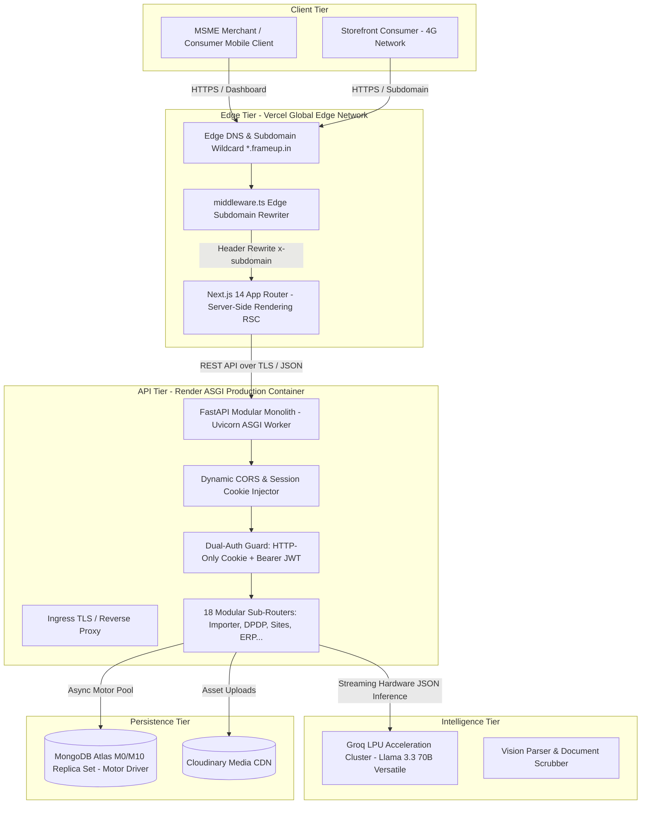
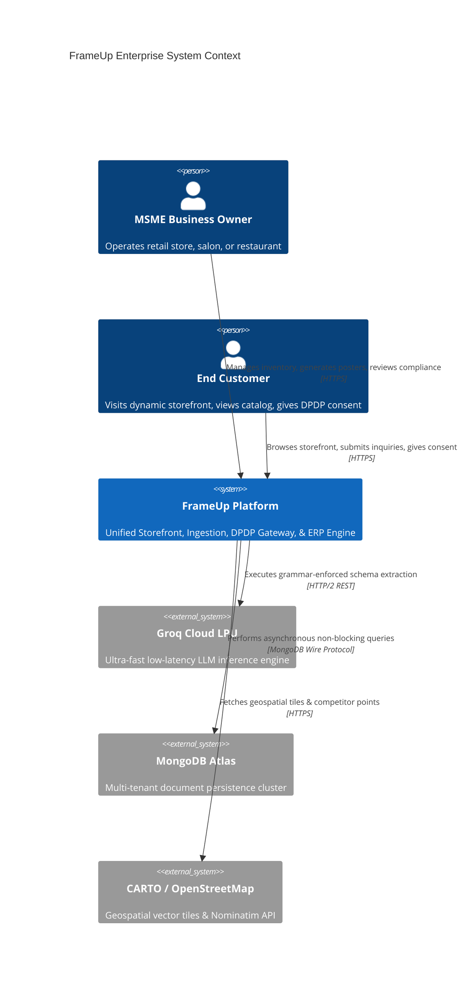
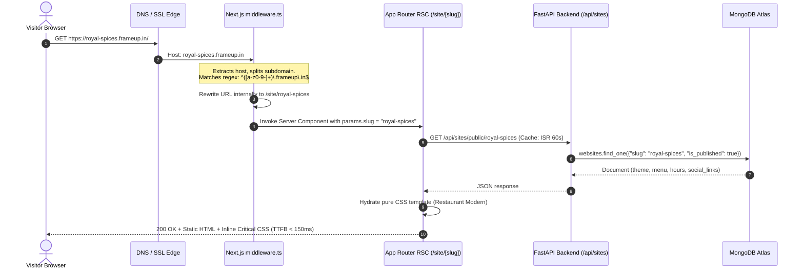

# 03. System Architecture & Distributed Topologies

## 3. System Architecture

### 3.1 Architectural Style & Topology
FrameUp employs a **Decoupled Edge-Accelerated Micro-Monolith Architecture**. Rather than decomposing prematurely into distributed microservices with heavy gRPC network serialization costs and distributed transaction overhead (Two-Phase Commit / Saga orchestrators), FrameUp consolidates business capabilities into a modular, asynchronous FastAPI Python ASGI core, bridged with an ultra-low latency Next.js 14 App Router deployed at the Vercel Edge.

---

### 3.2 C4 Context & Container Models

#### C4 Context (Level 1)

---

### 3.3 Edge Subdomain Routing Architecture
One of the core architectural differentiators of FrameUp is its **zero-configuration instant multi-tenant storefront**. When a merchant registers a slug (e.g. `royal-spices`), the public site immediately becomes accessible at both `https://frameup.in/site/royal-spices` and `https://royal-spices.frameup.in`.

---

### 3.4 Data Flow Architecture

#### Write Pipeline (Transactional & Event-Driven)
1. Ingestion of raw payloads into FastAPI controller via Pydantic model validation.
2. Async context manager resolves MongoDB collection handle from Motor client pool.
3. Transactional validation enforces uniqueness and DPDP PII redacting rules.
4. Storage written to MongoDB with write concern `w: "majority"`.
5. Background notification / audit log dispatched via `atlasos` lightweight worker queue.

#### Read Pipeline (Edge-Cached & Query Optimized)
1. Read requests hit Next.js 14 Server Components.
2. Public storefront requests utilize `fetch(..., { next: { revalidate: 60 } })` for Incremental Static Regeneration (ISR).
3. Private dashboard queries pass through authenticated reverse proxy route handlers, attaching HttpOnly session tokens.
4. Database reads utilize compound indexes `(owner_id: 1, created_at: -1)`, yielding single-digit millisecond index scans (`IXSCAN`).
