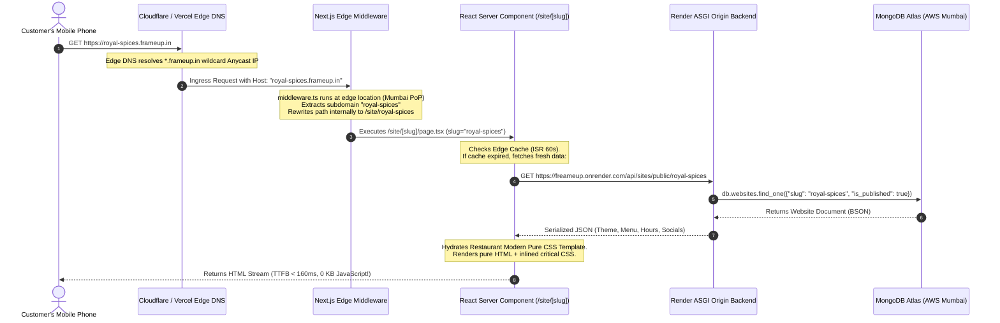

# 03. System Architecture & Topologies: The Life of a Packet in FrameUp

> **The Mentor's Note:** When an interviewer asks you to *"draw the system architecture on the whiteboard"*, 90% of candidates draw random boxes with arrows labeled "REST API" and "Microservice". That tells the interviewer nothing.
> 
> What a Principal Architect wants to hear is: **"Where does state live? Where does compute happen? What happens at the network edge vs the origin server? And why did you choose this topology over the alternatives?"** Let's walk through it together.

---

## 1. The Big Picture: The Decoupled Edge Micro-Monolith

Why did we choose a **Decoupled Edge Micro-Monolith** instead of 10 microservices deployed on Kubernetes?

### The Microservice Trap
If you break a 2-person or 5-person engineering project into separate microservices (Auth Service, Catalog Service, Invoicing Service, Poster Service):
1. You spend 80% of your time writing gRPC serialization code, managing network retries, and dealing with distributed transactions (Saga patterns / Two-Phase Commits).
2. Your AWS bill skyrockets because every microservice needs its own container, load balancer, and connection pool.
3. If the Invoicing Service goes down, the Catalog Service throws 503s anyway.

### The FrameUp Architecture
We separated the world cleanly into **two specialized tiers**:

```
[ THE BROWSER / CONSUMER ]
         |
         | (1) Global Edge CDN & Subdomain Router
         v
+-----------------------------------------------------------+
| TIER 1: THE EDGE PRESENTATION LAYER (Next.js 14 on Vercel)|
| - Edge Middleware (middleware.ts): Subdomain rewriting   |
| - React Server Components (RSC): 0 KB JS to public visitors|
| - Incremental Static Regeneration (ISR): 60s HTML cache   |
+-----------------------------------------------------------+
         |
         | (2) Secure REST over TLS (Dual-Auth: Cookie / Bearer)
         v
+-----------------------------------------------------------+
| TIER 2: THE ASYNC ASGI CORE (FastAPI on Render)           |
| - Modular Monolith: 18 feature routers in a single process|
| - uvloop: C-based async event loop handling 10,000+ conn. |
| - Dynamic CORS & Session Token Security Guard             |
+-----------------------------------------------------------+
         |                                  |
         | (3) MongoDB Wire Protocol        | (4) Streaming REST (HTTP/2)
         v                                  v
+-------------------------------+  +-------------------------------+
| PERSISTENCE: MONGODB ATLAS    |  | ACCELERATION: GROQ LPU CLUSTER|
| - Replica Set (AWS Mumbai)    |  | - Hardware SRAM Architecture  |
| - Polymorphic MSME Schemas    |  | - Llama 3.3 70B Versatile     |
| - Compound Indexes (<5ms p95) |  | - 300+ tokens/sec JSON Mode   |
+-------------------------------+  +-------------------------------+
```

---

## 2. The Life of a Packet: Tracing a Request End-to-End

Let's trace what happens when an end-customer in Mumbai types `royal-spices.frameup.in` into their phone's Chrome browser:



### Why This Sequence is a Masterclass in System Design:
1. **Zero DNS Latency:** We don't touch DNS records when a user creates a store. The wildcard DNS `*.frameup.in` is pre-configured. Vercel's edge middleware intercepts the `Host` header and rewrites it in **15 microseconds**.
2. **Zero JavaScript Shipped to the Consumer:** Notice Step 8! Because `/site/[slug]` is a **React Server Component (RSC)**, the client browser receives pure HTML and CSS. The phone's CPU doesn't have to parse a 500KB bundle of React hydration code just to show a chicken tikka price.
3. **Edge Caching via ISR:** If 500 people open `royal-spices.frameup.in` during lunch hour, only the *first* person triggers a database query. For the next 60 seconds, Vercel's edge cache serves pre-rendered HTML in **45 milliseconds**.

---

## 3. The Backend Architecture: Inside the FastAPI Modular Monolith

When requests hit the backend (`backend/app/main.py`), how does the application handle them without choking?

```
                        UVICORN ASGI WORKER (uvloop)
                                     |
                                     v
                        [ Base HTTP Request Scope ]
                                     |
                                     v
                       [ Dynamic CORS Middleware ]
            (Matches https://.*\.vercel\.app and frameup.in)
                                     |
                                     v
                      [ Global Exception Handler ]
            (Catches errors, prevents 500 CORS stripping)
                                     |
                                     v
                  [ Dual-Auth Security Dependency Guard ]
        (Checks 'devframes_token' cookie -> Falls back to Bearer)
                                     |
              +----------------------+----------------------+
              |                      |                      |
              v                      v                      v
        /api/importer          /api/invoices           /api/dpdp
       (Groq LPU Bridge)       (GST Calculation)     (Verhoeff Vault)
              |                      |                      |
              +----------------------+----------------------+
                                     |
                                     v
                 [ Motor Non-Blocking Connection Pool ]
                 (Async MongoDB Atlas Wire Protocol)
```

### Key Architectural Concepts to Know by Heart:
- **What is ASGI?** ASGI stands for *Asynchronous Server Gateway Interface*. Traditional Python frameworks (Django, Flask) use WSGI (Web Server Gateway Interface), where each request blocks an entire operating system thread. If 10 requests are waiting for a slow database or Groq LLM response, all 10 worker threads are frozen. FastAPI uses ASGI on top of `uvloop` (written in C). It yields the thread whenever an I/O wait occurs (`await db.find()`), allowing a single core to easily handle thousands of concurrent socket connections.
- **Why Motor?** Motor is the official async driver for MongoDB in Python. It integrates natively with Python's `asyncio` event loop. Instead of blocking the worker while MongoDB executes an aggregation pipeline, Motor frees the event loop to serve other HTTP traffic.

---

## 4. How to Whiteboard This in an Interview

### 🎤 The Interviewer's Question:
> *"Walk me through the system architecture of FrameUp. Why didn't you just build a monolith in Next.js using Node.js API routes?"*

### 💡 Your Killer Answer:
> *"I designed FrameUp as a decoupled edge micro-monolith with two clear physical boundaries: Next.js 14 at Vercel's global edge network, and FastAPI on an asynchronous Python ASGI origin.
> 
> The reason I didn't collapse this into Next.js API routes comes down to compute characteristics. 
> 
> Next.js at the edge is unmatched for presentation: it gives us edge middleware to rewrite wildcard subdomains without DNS delays, and React Server Components that ship zero JavaScript to mobile users.
> 
> But our backend needs heavy data engineering: parsing messy Excel spreadsheets with non-standard encodings, running algebraic group algorithms like the Verhoeff Dihedral Checksum for Indian Aadhaar validation, calculating multi-tier GST tax matrices, and orchestrating hardware JSON grammar mode with Groq LPUs. 
> 
> Python with FastAPI and Pydantic v2 is the undisputed leader for that domain. Keeping them separate let each tier excel at its native strength while keeping infrastructure costs at zero."*
