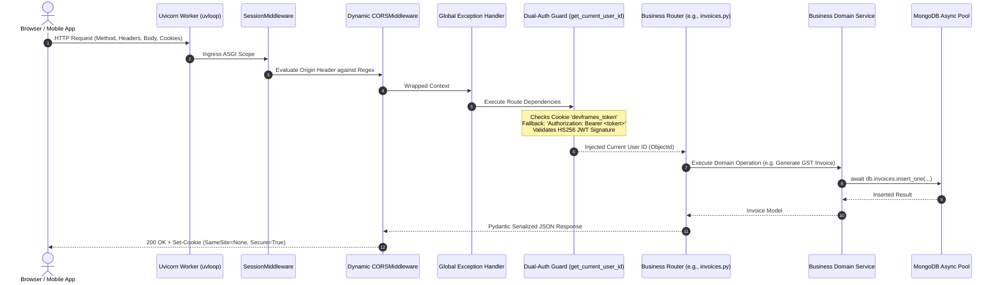

# 04. Backend Engineering & Codebase Architecture

## Document Information
- **Runtime:** Python 3.11 / Uvicorn ASGI
- **Framework:** FastAPI `0.111.0`
- **Architecture Pattern:** Modular Clean Monolith with Dependency Injection
- **Database Driver:** Motor AsyncIOMotorClient

---

## 5. Codebase Organization & Directory Structure

```
backend/
├── app/
│   ├── config.py                 # Pydantic BaseSettings, env resolution, CORS regex
│   ├── database.py               # Async Motor client, lifespan connection pool
│   ├── main.py                   # ASGI application entrypoint, middleware, router mount
│   ├── data/                     # Static catalogs (fonts, color palettes, stock imagery)
│   ├── models/                   # Pydantic request/response & DB persistence schemas
│   │   ├── business.py
│   │   ├── poster.py
│   │   ├── user.py
│   │   └── website.py
│   ├── routers/                  # 18 Modular Feature Controllers
│   │   ├── ai.py                 # Groq LPU copy generation & translation
│   │   ├── ai_agent.py           # Multi-step conversational assistant
│   │   ├── auth.py               # Email/Password JWT auth & dual-cookie injection
│   │   ├── auth_google.py        # Google OAuth2 authorization code flow
│   │   ├── business.py           # MSME tenant profile management
│   │   ├── dpdp_gateway.py       # Statutory DPDP compliance & Verhoeff validation
│   │   ├── importer.py           # Multi-modal unstructured data ingestion
│   │   ├── inventory.py          # Real-time SKU stock tracking & reorder alerts
│   │   ├── invoices.py           # GST-compliant tax billing & calculations
│   │   ├── leads.py              # Inbound customer lead capture
│   │   ├── localization.py       # Vernacular language translation & currency
│   │   ├── loyalty.py            # Digital loyalty stamp cards & rewards
│   │   ├── marketplace.py        # Add-on integrations & templates
│   │   ├── operations.py         # Consolidated operational metrics
│   │   ├── posters.py            # Poster manifest synthesis & templates
│   │   ├── qr.py                 # Dynamic UPI & vCard QR code generator
│   │   ├── sites.py              # Multi-tenant storefront CRUD & publishing
│   │   ├── staff.py              # Employee management & access roles
│   │   └── suppliers.py          # Vendor profiles & purchase orders
│   ├── services/                 # Core Business Domain Logic
│   │   ├── groq_service.py       # Groq API client with JSON grammar enforcement
│   │   ├── importer_service.py   # Fuzzy column mapping & schema normalization
│   │   ├── render_resolver.py    # Edge template hydration resolver
│   │   └── template_engine.py    # Jinja2 & dynamic HTML compiler
│   └── templates/                # Jinja2 SSR storefront & section components
```

---

## 7. Backend Engineering & Request Lifecycle

### 7.1 The ASGI Request Lifecycle Flow


### 7.2 Critical Middleware Implementation Details

#### 1. Dynamic CORS Regex & Session Middleware
In production, frontend instances may deploy under variable Vercel preview URLs (`*-devframes.vercel.app`), local development hosts (`localhost:3000`), or custom production domains (`frameup.in`). A static origin whitelist breaks preview branches. FrameUp handles this via regex matching:

```python
# backend/app/main.py
app.add_middleware(
    CORSMiddleware,
    allow_origin_regex=r"https://.*\.vercel\.app$|https://frameup\.in$|http://localhost:3000$",
    allow_credentials=True,
    allow_methods=["*"],
    allow_headers=["*"],
)
```

#### 2. Global Exception Handler Preserving CORS
A common architectural defect in ASGI microservices occurs when an unhandled 500 Internal Server Error is thrown: default framework handlers strip CORS headers from the 500 response, causing the browser to throw a misleading `CORS error` instead of exposing the underlying 500 payload. FrameUp prevents this via an explicit exception interceptor:

```python
@app.exception_handler(Exception)
async def global_exception_handler(request: Request, exc: Exception):
    origin = request.headers.get("origin")
    response = JSONResponse(
        status_code=500,
        content={"detail": "Internal Server Error", "error": str(exc)}
    )
    if origin and is_allowed_origin(origin):
        response.headers["Access-Control-Allow-Origin"] = origin
        response.headers["Access-Control-Allow-Credentials"] = "true"
    return response
```

### 7.3 Dual-Auth Security Guard (`get_current_user_id`)
To support both browser clients (which require secure HTTP-Only `SameSite=None` cookies to mitigate XSS attacks) and mobile/headless API clients (which pass `Authorization: Bearer <jwt>`), the authentication guard implements a dual-resolution fallback mechanism:

```python
# backend/app/routers/auth.py
async def get_current_user_id(
    request: Request,
    authorization: Optional[str] = Header(None)
) -> str:
    token = None
    
    # Priority 1: Secure HTTP-Only Cookie
    cookie_token = request.cookies.get("devframes_token")
    if cookie_token:
        token = cookie_token
        
    # Priority 2: Authorization Header Fallback
    elif authorization and authorization.startswith("Bearer "):
        token = authorization.split(" ")[1]
        
    if not token:
        raise HTTPException(
            status_code=status.HTTP_401_UNAUTHORIZED,
            detail="Authentication token missing. Please log in.",
            headers={"WWW-Authenticate": "Bearer"},
        )
        
    try:
        payload = jwt.decode(token, settings.JWT_SECRET, algorithms=[settings.JWT_ALGORITHM])
        user_id: str = payload.get("sub")
        if not user_id:
            raise HTTPException(status_code=401, detail="Invalid token claims.")
        return user_id
    except JWTError:
        raise HTTPException(status_code=401, detail="Session expired or signature invalid.")
```

### 7.4 Service Layer Separation
Routers do not perform raw data manipulation or third-party API orchestration directly. They act as thin HTTP controllers:
1. **Controller Layer (`routers/`):** Validates HTTP request contracts, unwraps auth headers, calls services, formats responses.
2. **Service Layer (`services/`):** Implements business algorithms (Verhoeff checksum computation, fuzzy column matching, prompt construction, GST tax split logic).
3. **Data Access Layer (`database.py`):** Encapsulates non-blocking Motor queries and transaction sessions.
