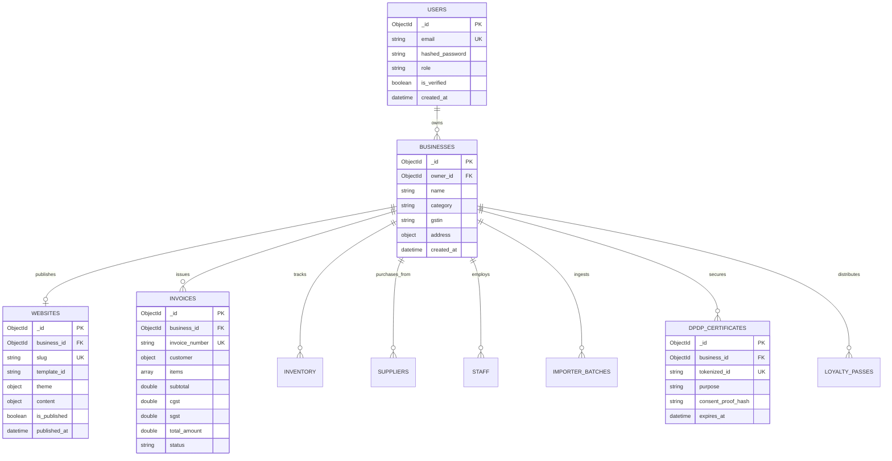

# 06. Database Design & Persistence Architecture

## 6. Database Design

### 6.1 Database Choice Rationale
FrameUp utilizes MongoDB Atlas due to the polymorphic nature of MSME business domains. Unlike traditional corporate ERPs where schemas remain static, an MSME digital operating system must model drastically divergent vertical entities:
- A **Restaurant** stores categories, spice levels, allergen tags, and ingredient modifiers.
- A **Salon** stores stylist seniorities, duration intervals, service packages, and gender categories.
- An **Automotive Spare Parts Merchant** stores OEM part numbers, compatibility matrices, and GST HSN codes.

MongoDB allows storing these vertical-specific attributes inside polymorphic sub-documents without migrations, alter table locks, or sparse relational null-column bloat.

---

### 6.2 Entity-Relationship & Document Association Model


---

### 6.3 Detailed Collection Schemas

#### 1. `users` Collection
Stores authentication principals, roles, verification states, and OAuth metadata.
```json
{
  "$jsonSchema": {
    "bsonType": "object",
    "required": ["email", "role", "created_at"],
    "properties": {
      "_id": { "bsonType": "objectId" },
      "email": { "bsonType": "string", "pattern": "^[a-zA-Z0-9_.+-]+@[a-zA-Z0-9-]+\\.[a-zA-Z0-9-.]+$" },
      "hashed_password": { "bsonType": ["string", "null"] },
      "full_name": { "bsonType": "string" },
      "role": { "enum": ["merchant", "admin", "staff"] },
      "is_verified": { "bsonType": "bool" },
      "google_id": { "bsonType": ["string", "null"] },
      "created_at": { "bsonType": "date" },
      "updated_at": { "bsonType": "date" }
    }
  }
}
```

#### 2. `businesses` Collection
The tenant anchor document representing an MSME entity.
```json
{
  "_id": "ObjectId('66d1a980e1b2c3d4e5f60001')",
  "owner_id": "ObjectId('66d1a8e0e1b2c3d4e5f60000')",
  "name": "Saffron Spice Bistro",
  "category": "restaurant",
  "phone": "+919876543210",
  "email": "contact@saffronspice.in",
  "gstin": "27AAPFU0931F1ZV",
  "address": {
    "line1": "Shop 4, Linking Road, Bandra West",
    "city": "Mumbai",
    "state": "Maharashtra",
    "pincode": "400050",
    "coordinates": { "lat": 19.0596, "lng": 72.8295 }
  },
  "settings": {
    "currency": "INR",
    "default_tax_rate": 5.0,
    "vernacular_language": "hi"
  },
  "created_at": "ISODate('2026-08-30T10:00:00Z')"
}
```

#### 3. `websites` Collection
Defines the edge-rendered storefront state, templates, themes, and content blocks.
```json
{
  "_id": "ObjectId('66d1b240e1b2c3d4e5f60002')",
  "business_id": "ObjectId('66d1a980e1b2c3d4e5f60001')",
  "owner_id": "ObjectId('66d1a8e0e1b2c3d4e5f60000')",
  "slug": "saffron-spice-bistro",
  "vertical": "restaurant",
  "template_id": "restaurant_modern",
  "is_published": true,
  "theme": {
    "primary_color": "#D97706",
    "secondary_color": "#1F2937",
    "font_family": "Plus Jakarta Sans",
    "border_radius": "0.75rem"
  },
  "content": {
    "hero": {
      "headline": "Authentic Awadhi & Mughlai Cuisine",
      "subheadline": "Slow-cooked dum biryanis and royal kebabs in the heart of Bandra",
      "cta_text": "Book Table",
      "background_image": "https://res.cloudinary.com/frameup/image/upload/v1/hero_bistro.jpg"
    },
    "menu_sections": [
      {
        "category": "Royal Kebabs",
        "items": [
          { "name": "Galouti Kebab", "price": 420.00, "is_veg": false, "desc": "Melt-in-mouth mutton patties" },
          { "name": "Paneer Tikka Angara", "price": 340.00, "is_veg": true, "desc": "Charred cottage cheese in smoked red masala" }
        ]
      }
    ],
    "hours": {
      "monday_saturday": "11:30 AM - 11:30 PM",
      "sunday": "11:30 AM - Midnight"
    },
    "social_links": {
      "instagram": "https://instagram.com/saffronspice",
      "whatsapp": "https://wa.me/919876543210"
    }
  },
  "published_at": "ISODate('2026-08-30T10:15:00Z')"
}
```

#### 4. `importer_batches` Collection
Tracks asynchronous AI parsing jobs for unstructured file uploads.
```json
{
  "_id": "ObjectId('66d1c8f0e1b2c3d4e5f60003')",
  "business_id": "ObjectId('66d1a980e1b2c3d4e5f60001')",
  "original_filename": "august_raw_menu.csv",
  "file_type": "text/csv",
  "total_records": 48,
  "successful_records": 48,
  "error_records": 0,
  "status": "completed",
  "inferred_schema": {
    "name": "col_0",
    "price": "col_1",
    "category": "col_2",
    "is_veg": "col_3"
  },
  "extracted_items": [
    { "name": "Butter Chicken", "price": 380, "confidence": 0.992 }
  ],
  "created_at": "ISODate('2026-08-30T11:00:00Z')"
}
```

#### 5. `dpdp_certificates` Collection (Statutory Privacy Vault)
Stores anonymized consent records, Verhoeff-validated tokens, and SHA-256 audit hashes.
```json
{
  "_id": "ObjectId('66d1d410e1b2c3d4e5f60004')",
  "business_id": "ObjectId('66d1a980e1b2c3d4e5f60001')",
  "masked_phone": "+91******3210",
  "masked_aadhaar": "XXXXXXXX1234",
  "purpose": "Order Fulfillment & Loyalty Rewards",
  "consent_given": true,
  "ip_address_hash": "e3b0c44298fc1c149afbf4c8996fb92427ae41e4649b934ca495991b7852b855",
  "user_agent": "Mozilla/5.0 (iPhone; CPU iPhone OS 17_4)",
  "audit_signature": "sha256$8f9a2b1c4e...",
  "retention_period_days": 180,
  "created_at": "ISODate('2026-08-30T11:20:00Z')",
  "expires_at": "ISODate('2027-02-26T11:20:00Z')"
}
```

#### 6. `invoices` Collection (GST Compliant Billing)
```json
{
  "_id": "ObjectId('66d1e520e1b2c3d4e5f60005')",
  "business_id": "ObjectId('66d1a980e1b2c3d4e5f60001')",
  "invoice_number": "INV-2026-0042",
  "customer_name": "Rohan Gupta",
  "customer_phone": "+919988776655",
  "items": [
    { "item_id": "ITM-01", "name": "Galouti Kebab", "qty": 2, "unit_price": 420.0, "hsn": "2106", "tax_rate": 5.0 }
  ],
  "subtotal": 840.0,
  "cgst": 21.0,
  "sgst": 21.0,
  "total_amount": 882.0,
  "payment_mode": "UPI",
  "payment_status": "PAID",
  "created_at": "ISODate('2026-08-30T12:00:00Z')"
}
```

#### 7. `inventory` Collection
```json
{
  "_id": "ObjectId('66d1f110e1b2c3d4e5f60006')",
  "business_id": "ObjectId('66d1a980e1b2c3d4e5f60001')",
  "sku": "SKU-MTON-01",
  "name": "Mutton Boneless (Fresh)",
  "category": "Meat & Poultry",
  "quantity": 14.5,
  "unit": "kg",
  "reorder_threshold": 5.0,
  "cost_price": 650.0,
  "selling_price": 0.0,
  "supplier_id": "ObjectId('66d1f990e1b2c3d4e5f60007')",
  "updated_at": "ISODate('2026-08-30T12:15:00Z')"
}
```

---

### 6.4 Indexing Strategy & Performance Tuning

To avoid full collection scans (`COLLSCAN`), FrameUp enforces compound and unique indexes matching query predicates:

```python
# Database Index Initialization Protocol (backend/app/database.py)
await db.users.create_index([("email", 1)], unique=True)
await db.websites.create_index([("slug", 1)], unique=True)
await db.websites.create_index([("business_id", 1), ("is_published", 1)])
await db.invoices.create_index([("business_id", 1), ("invoice_number", 1)], unique=True)
await db.invoices.create_index([("business_id", 1), ("created_at", -1)])
await db.inventory.create_index([("business_id", 1), ("sku", 1)], unique=True)
await db.inventory.create_index([("business_id", 1), ("quantity", 1)])
await db.dpdp_certificates.create_index([("business_id", 1), ("created_at", -1)])
await db.dpdp_certificates.create_index([("expires_at", 1)], expireAfterSeconds=0) # TTL Index
```

### 6.5 Aggregation Pipelines

#### GST Monthly Tax Liability Aggregation
```python
pipeline = [
    {
        "$match": {
            "business_id": business_id,
            "payment_status": "PAID",
            "created_at": {"$gte": start_date, "$lte": end_date}
        }
    },
    {
        "$group": {
            "_id": None,
            "total_turnover": {"$sum": "$subtotal"},
            "total_cgst": {"$sum": "$cgst"},
            "total_sgst": {"$sum": "$sgst"},
            "total_gross": {"$sum": "$total_amount"},
            "invoice_count": {"$sum": 1}
        }
    }
]
summary = await db.invoices.aggregate(pipeline).to_list(length=1)
```

### 6.6 Sharding Key Selection
When dataset sizes exceed the single replica set threshold (>100GB):
- **Selected Shard Key:** `{ "business_id": "hashed" }`
- **Rationale:** Guarantees uniform hash distribution across shards, eliminating write hotspots while keeping all queries scoped to a single tenant isolated to an individual shard with zero multi-shard scatter-gather overhead.
