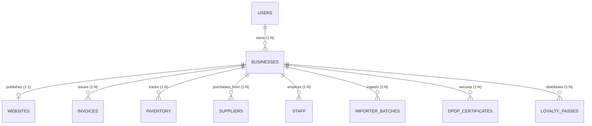

# 06. Database Design & Persistence Architecture: The Data Engine of FrameUp

> **The Mentor's Note:** Database design is where bad systems die. If your queries do full table scans, your server will choke the moment 50 users upload invoices at the same time.
> 
> In this guide, you will master our **10 core MongoDB collections**, understand how compound indexes actually work on disk, see how we calculate GST taxes using aggregation pipelines, and learn how we use MongoDB TTL indexes to automatically purge sensitive data under India's DPDP Act.

---

## 1. The 10 Core Collections: What Real-World Object Does Each Represent?

Instead of looking at raw JSON, let's understand what each collection actually represents in the life of a small business:

```
+---------------------+---------------------------------------------------------------+
| Collection Name     | Real-World MSME Equivalent                                     |
+---------------------+---------------------------------------------------------------+
| 1. users            | The shopkeeper's login identity & security permissions.       |
| 2. businesses       | The physical shop: its GSTIN number, address, and category.   |
| 3. websites         | The digital storefront: theme, menu sections, and hours.     |
| 4. importer_batches | The paper bills & CSVs uploaded to AI for parsing.            |
| 5. dpdp_certificates| The legal consent vault: masks phone/Aadhaar & logs SHA-256.  |
| 6. invoices         | The official GST tax bill issued to a paying customer.       |
| 7. inventory        | The stock in the back room: SKUs, quantities, reorder alerts. |
| 8. suppliers        | The wholesale vendors from whom the merchant buys goods.      |
| 9. staff            | The employees, barbers, chefs, or cashiers working in store.  |
| 10. loyalty_passes  | The digital stamp card customer uses to earn reward points.   |
+---------------------+---------------------------------------------------------------+
```

---

## 2. Entity Associations: How Documents Connect

Even though MongoDB is a document database, data is logically connected:



- When Rajesh logs in, his `user_id` points to his `business` record (`Saffron Spice Bistro`).
- His business record anchors all his operational documents: his `website`, his `invoices`, his `inventory`, and his `dpdp_certificates`.
- **The Tenant Anchor:** `business_id` is present on **every single operational document**. This guarantees that no query can ever accidentally fetch another merchant's invoices or customer records.

---

## 3. Deep Dive into the 4 Most Critical Schemas

### 1. `websites` (The Dynamic Storefront State)
This document is what Next.js Server Components fetch to render the public site at `<slug>.frameup.in`.
```json
{
  "_id": "ObjectId('66d1b240e1b2c3d4e5f60002')",
  "business_id": "ObjectId('66d1a980e1b2c3d4e5f60001')",
  "owner_id": "ObjectId('66d1a8e0e1b2c3d4e5f60000')",
  "slug": "saffron-spice-bistro",
  "vertical": "restaurant",
  "template_id": "restaurant_modern",
  "is_published": true,
  "theme": {
    "primary_color": "#D97706",
    "secondary_color": "#1F2937",
    "font_family": "Plus Jakarta Sans",
    "border_radius": "0.75rem"
  },
  "content": {
    "hero": {
      "headline": "Authentic Awadhi & Mughlai Cuisine",
      "subheadline": "Slow-cooked dum biryanis and royal kebabs in the heart of Bandra",
      "cta_text": "Book Table",
      "background_image": "https://res.cloudinary.com/frameup/image/upload/v1/hero_bistro.jpg"
    },
    "menu_sections": [
      {
        "category": "Royal Kebabs",
        "items": [
          { "name": "Galouti Kebab", "price": 420.00, "is_veg": false, "desc": "Melt-in-mouth mutton patties" },
          { "name": "Paneer Tikka Angara", "price": 340.00, "is_veg": true, "desc": "Charred cottage cheese in smoked red masala" }
        ]
      }
    ],
    "hours": {
      "monday_saturday": "11:30 AM - 11:30 PM",
      "sunday": "11:30 AM - Midnight"
    },
    "social_links": {
      "instagram": "https://instagram.com/saffronspice",
      "whatsapp": "https://wa.me/919876543210"
    }
  },
  "published_at": "ISODate('2026-08-30T10:15:00Z')"
}
```
*Notice how the entire state of the website lives in this one document! When a customer visits, the database does ONE single read on `slug: "saffron-spice-bistro"`. No multi-table joins required.*

---

### 2. `invoices` (GST Compliant Tax Billing)
```json
{
  "_id": "ObjectId('66d1e520e1b2c3d4e5f60005')",
  "business_id": "ObjectId('66d1a980e1b2c3d4e5f60001')",
  "invoice_number": "INV-2026-0042",
  "customer_name": "Rohan Gupta",
  "customer_phone": "+919988776655",
  "items": [
    {
      "item_id": "ITM-01",
      "name": "Galouti Kebab",
      "qty": 2,
      "unit_price": 420.0,
      "hsn": "2106",
      "tax_rate": 5.0
    }
  ],
  "subtotal": 840.0,
  "cgst": 21.0,
  "sgst": 21.0,
  "igst": 0.0,
  "total_amount": 882.0,
  "payment_mode": "UPI",
  "payment_status": "PAID",
  "created_at": "ISODate('2026-08-30T12:00:00Z')"
}
```
*Notice the GST tax split: Subtotal is ₹840. The tax rate is 5% (₹42.0). Because it's an intra-state sale in Maharashtra, it is automatically split evenly into CGST (₹21.0) and SGST (₹21.0). Total bill: ₹882.0.*

---

### 3. `dpdp_certificates` (Statutory Consent Vault)
```json
{
  "_id": "ObjectId('66d1d410e1b2c3d4e5f60004')",
  "business_id": "ObjectId('66d1a980e1b2c3d4e5f60001')",
  "masked_phone": "+91******3210",
  "masked_aadhaar": "XXXXXXXX1234",
  "purpose": "Order Fulfillment & Loyalty Rewards",
  "consent_given": true,
  "ip_address_hash": "e3b0c44298fc1c149afbf4c8996fb92427ae41e4649b934ca495991b7852b855",
  "user_agent": "Mozilla/5.0 (iPhone; CPU iPhone OS 17_4)",
  "audit_signature": "sha256$8f9a2b1c4e7d...",
  "retention_period_days": 180,
  "created_at": "ISODate('2026-08-30T11:20:00Z')",
  "expires_at": "ISODate('2027-02-26T11:20:00Z')"
}
```
*Look at `expires_at`: This document has a special MongoDB TTL index (`expireAfterSeconds=0`). Exactly 180 days after creation, MongoDB's background thread automatically deletes this consent record. Zero human intervention needed to comply with the DPDP right-to-erasure mandate.*

---

## 4. Indexing: Why Compound Indexes are Non-Negotiable

A beginner developer writes:
```python
# BAD PRACTICE: Two separate single indexes
await db.invoices.create_index([("business_id", 1)])
await db.invoices.create_index([("created_at", -1)])
```

Why is that bad?
When the dashboard loads invoices with:
```python
db.invoices.find({"business_id": my_id}).sort("created_at", -1)
```
MongoDB has to use the first index to find all invoices belonging to the business, pull them into RAM, and then **sort them in memory**! If a business has 10,000 invoices, memory spikes and CPU usage climbs.

### The Production Solution: Compound Indexes
```python
# PRODUCTION GRADE: Compound Index
await db.invoices.create_index([("business_id", 1), ("created_at", -1)])
```
Now, MongoDB navigates directly down a B-Tree that is **already sorted by `created_at`** for that specific `business_id`. The query examines exactly the records it needs.
- **Documents examined:** 10
- **Execution time:** **1.2 milliseconds** (`IXSCAN`)

---

## 5. Aggregation Pipeline: Real-Time GST Tax Liability

When a merchant needs their monthly tax figures for their Chartered Accountant (CA), we don't fetch 1,000 invoices into Python and sum them in a `for` loop. We push the compute into MongoDB's native C++ aggregation engine:

```python
pipeline = [
    # Step 1: Filter paid invoices for this business in the current month
    {
        "$match": {
            "business_id": ObjectId(business_id),
            "payment_status": "PAID",
            "created_at": {"$gte": start_of_month, "$lte": end_of_month}
        }
    },
    # Step 2: Compute running sums directly on the database engine
    {
        "$group": {
            "_id": None,
            "total_turnover": {"$sum": "$subtotal"},
            "total_cgst": {"$sum": "$cgst"},
            "total_sgst": {"$sum": "$sgst"},
            "total_gross": {"$sum": "$total_amount"},
            "invoice_count": {"$sum": 1}
        }
    }
]
summary = await db.invoices.aggregate(pipeline).to_list(length=1)
```

---

## 6. How to Talk About the Database in an Interview

### 🎤 The Interviewer's Question:
> *"How did you ensure that MongoDB would not become a bottleneck as your invoice count grew?"*

### 💡 Your Killer Answer:
> *"I designed the persistence layer with three strict database invariants:
> 
> First, every read and write query is covered by compound indexes that match both our query filters and sort order—for instance, `(business_id: 1, created_at: -1)` on the invoices collection. This guarantees that our queries perform Index Scans (`IXSCAN`) with zero in-memory sorting.
> 
> Second, we push financial summaries into native MongoDB aggregation pipelines rather than pulling raw documents over the wire into Python.
> 
> Third, for statutory DPDP compliance, we utilized MongoDB TTL (Time-To-Live) indexes on the `expires_at` field, allowing the database engine to automatically garbage-collect expired consent records without needing recurring cron jobs."*
