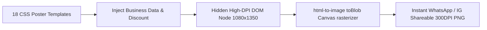

# 06. Frontend Engineering & Edge Subdomain Architecture

## Document Information
- **Framework:** Next.js `14.2.5` (App Router)
- **Runtime:** Vercel Edge Runtime & Node.js Serverless
- **Styling Architecture:** Tailwind CSS `3.4.1` + PostCSS + CSS Variables
- **Rendering Archetypes:** React Server Components (RSC) + Selective Client Islands

---

## 9. Frontend Architecture & Edge Rendering

### 9.1 Directory Structure & App Router Layout
```
frontend/
├── app/
│   ├── (auth)/                   # Route group for unauthenticated flows
│   │   ├── login/page.tsx        # Email/password & Google OAuth entrypoint
│   │   └── signup/page.tsx       # Merchant onboarding & registration
│   ├── create/                   # Multi-step site creation wizard
│   │   ├── page.tsx              # Business profile & vertical selection
│   │   └── style/page.tsx        # Palette, typography & layout picker
│   ├── dashboard/                # Authenticated Merchant Enterprise OS
│   │   ├── ai-agent/page.tsx     # Conversational business assistant
│   │   ├── ai-importer/page.tsx  # Drag-and-drop unstructured data ingestion
│   │   ├── dpdp-gateway/page.tsx # Statutory consent manager & audit certificate viewer
│   │   ├── inventory/page.tsx    # Real-time SKU tracking with low-stock alerts
│   │   ├── invoices/page.tsx     # GST tax invoice generator & PDF compiler
│   │   ├── layout.tsx            # Persistent sidebar, header, & auth guard
│   │   ├── localization/page.tsx # Vernacular language translator
│   │   ├── loyalty/page.tsx      # Digital loyalty cards & reward passes
│   │   ├── operations/page.tsx   # Consolidated financial & footfall metrics
│   │   ├── page.tsx              # Main analytics command center
│   │   ├── posters/page.tsx      # 18 Pure CSS vector-free graphic studio
│   │   ├── staff/page.tsx        # Employee role directory
│   │   └── suppliers/page.tsx    # Vendor supply chains & orders
│   ├── preview/[slug]/page.tsx   # Authenticated live preview sandbox
│   ├── site/[slug]/page.tsx      # Public edge-rendered storefront (RSC)
│   ├── workshop/[slug]/page.tsx  # WYSIWYG live site customizer & block editor
│   ├── layout.tsx                # Root layout with font optimization & toast providers
│   └── page.tsx                  # Public landing page & marketing hero
├── components/                   # Reusable UI component library
├── lib/                          # API clients, auth helpers, utility functions
├── middleware.ts                 # Edge subdomain resolution & route interceptor
└── public/                       # Static brand assets & template seeds
```

---

### 9.2 Edge Subdomain Resolution (`middleware.ts`)
The edge middleware intercepts every incoming HTTP request at Vercel’s global Edge nodes before the application server executes. It inspects the `Host` header to determine whether the incoming request is targeting a custom merchant subdomain:

```typescript
// frontend/middleware.ts
import { NextRequest, NextResponse } from "next/server";

export const config = {
  matcher: [
    /*
     * Match all request paths except for the ones starting with:
     * - api (API routes)
     * - _next/static (static files)
     * - _next/image (image optimization files)
     * - favicon.ico (favicon file)
     * - public files with extensions (.png, .jpg, .svg)
     */
    "/((?!api/|_next/static|_next/image|favicon.ico|.*\\..*).*)",
  ],
};

export function middleware(req: NextRequest) {
  const url = req.nextUrl;
  const hostname = req.headers.get("host") || "";

  // Define root production and staging domains
  const rootDomains = ["frameup.in", "devframes-presence.vercel.app", "localhost:3000"];
  
  // Extract subdomain if request arrives via <subdomain>.frameup.in
  let currentHost = hostname;
  for (const root of rootDomains) {
    if (hostname.endsWith(`.${root}`)) {
      currentHost = hostname.replace(`.${root}`, "");
      break;
    }
  }

  // If a valid merchant subdomain is detected (excluding 'www' and 'admin')
  if (currentHost !== hostname && currentHost !== "www" && currentHost !== "admin") {
    // Rewrite internally to the edge storefront route /site/[slug]
    return NextResponse.rewrite(new URL(`/site/${currentHost}${url.pathname}`, req.url));
  }

  return NextResponse.next();
}
```

---

### 9.3 Server Components (RSC) vs Client Components

#### Edge Storefront (`/site/[slug]/page.tsx` - RSC)
Public storefronts render exclusively as React Server Components. They do not ship client-side JavaScript for rendering headers, menus, or pricing cards, resulting in a **0 KB JavaScript payload** for static views:

```typescript
// Server Component: zero client bundle, sub-150ms TTFB
export default async function PublicStorefront({ params }: { params: { slug: string } }) {
  const siteData = await getSiteBySlug(params.slug); // Cached fetch with ISR (revalidate: 60)
  
  if (!siteData || !siteData.is_published) {
    return notFound();
  }

  return (
    <main className={`theme-container font-${siteData.theme.font_family}`}>
      <StorefrontHero content={siteData.content.hero} theme={siteData.theme} />
      <StorefrontMenu sections={siteData.content.menu_sections} />
      <StorefrontLocation address={siteData.content.address} hours={siteData.content.hours} />
      <StorefrontFooter social={siteData.content.social_links} />
    </main>
  );
}
```

#### Interactive Dashboard (`/dashboard/*` - Client Islands)
Dashboard views utilize `"use client"` directives to provide optimistic updates, drag-and-drop batch uploaders, interactive charts, and real-time state synchronization via React hooks.

---

### 9.4 Vector-Free Pure CSS Dynamic Poster Studio
To deliver marketing graphics for WhatsApp and Instagram without running costly server-side Chromium instances, FrameUp executes graphic synthesis directly inside the browser using pure CSS and DOM-to-Canvas rasterization:



#### Client-Side Rasterization Implementation
```typescript
// frontend/app/dashboard/posters/page.tsx
import { toBlob } from 'html-to-image';

async function exportHighResPoster(elementId: string, filename: string) {
  const node = document.getElementById(elementId);
  if (!node) return;

  // Render DOM element to Blob at 3x pixel ratio for print/retina sharpness
  const blob = await toBlob(node, {
    quality: 0.95,
    pixelRatio: 3, // 1080px x 1350px ultra-crisp output
    cacheBust: true,
  });

  if (!blob) throw new Error("Canvas rasterization failed");

  const url = URL.createObjectURL(blob);
  const link = document.createElement('a');
  link.download = `${filename}.png`;
  link.href = url;
  link.click();
  URL.revokeObjectURL(url);
}
```

### 9.5 Design Token System & Typography
The interface adheres strictly to an accessible, high-contrast dark/neutral design system:
- **Primary Typography:** `Plus Jakarta Sans` (System-optimized sans-serif with high x-height for mobile legibility).
- **Secondary / Display:** `Space Grotesk` & `Inter`.
- **Palette:** Deep Charcoal base (`#09090B`), Midnight surface (`#18181B`), Accent Emerald (`#10B981`), Warning Amber (`#F59E0B`), Danger Crimson (`#EF4444`).
- **Touch Targets:** Minimum $48\text{px} \times 48\text{px}$ touch zones on all buttons and actionable icons to ensure friction-free single-hand operation on budget Android devices.
