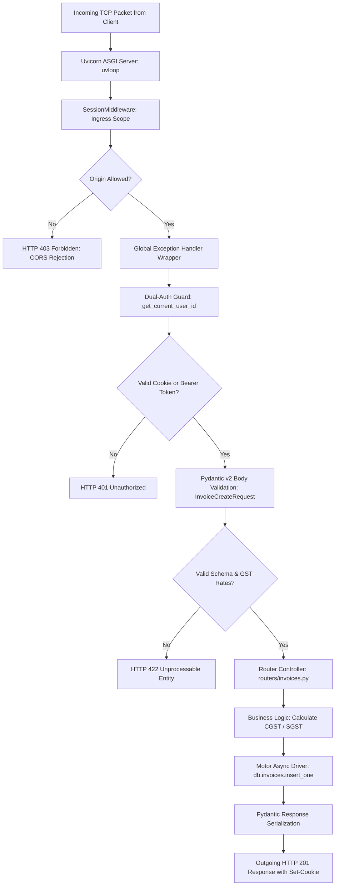

# 07. Backend Engineering & Request Lifecycle: The Engine Under the Hood

> **The Mentor's Note:** Many developers think backend engineering is just writing `app.get("/items")` and returning a dictionary. But in a production system, the HTTP layer is where things get ugly: cross-origin browser policies, expired session cookies, dropped database connections, and unexpected 500 crashes.
> 
> In this guide, you will understand the **FastAPI ASGI request lifecycle**, learn how our **Dual-Auth Guard** protects against both XSS and mobile session loss, and master the real production CORS bug that almost took down our deployment.

---

## 1. The ASGI Mental Model: WSGI vs ASGI

To understand FastAPI, you must understand the difference between **WSGI** (Flask/Django) and **ASGI** (FastAPI):

```
+-----------------------------------------------------------------------------------+
| WSGI (Flask / Django): One Thread per Request                                    |
| Client 1 ----> [ Thread 1: Waiting for Database... (FROZEN) ]                    |
| Client 2 ----> [ Thread 2: Waiting for Groq LLM... (FROZEN) ]                    |
| Client 3 ----> [ Queued in backlog... Timeout! ]                                 |
+-----------------------------------------------------------------------------------+
| ASGI (FastAPI on uvloop): Single Event Loop with Asynchronous Coroutines          |
| Client 1 ----\                                                                    |
| Client 2 ------> [ Single Worker Thread: Yields control on 'await' ]              |
| Client 3 ----/   Handles 10,000+ concurrent connections while I/O waits!         |
+-----------------------------------------------------------------------------------+
```

When FastAPI encounters `await db.invoices.insert_one(...)` or `await client.chat.completions.create(...)`, it does **not** sit there blocking the CPU. It tells the Python event loop: *"Hey, wake me up when MongoDB or Groq sends back the data. In the meantime, let me process Client 2's request!"*

This is why FastAPI can run our entire platform on a single lightweight cloud instance without breaking a sweat.

---

## 2. The Complete Request Lifecycle: Step-by-Step

Let's trace what happens inside the Python process when a request arrives at `POST /api/invoices`:



---

## 3. The Dual-Auth Security Guard: Line-by-Line Intuition

One of the most elegant pieces of engineering in FrameUp is the **Dual-Auth Guard** in `backend/app/routers/auth.py`. 

### The Real-World Problem It Solves:
- If you only use **Authorization Bearer headers**, web browsers have to store the JWT in `localStorage`. If a malicious third-party script runs on the page, it can read `localStorage` and steal the user's session (**Cross-Site Scripting / XSS attack**).
- If you only use **HTTP-Only Cookies**, mobile apps, automated API tools, and cross-site requests across different domains (like `*.vercel.app` calling `*.onrender.com`) frequently drop unpartitioned cookies due to browser tracking protection.

### Our Solution: Dual-Transport Resolution
We accept **both**, prioritizing the secure HTTP-Only cookie, but seamlessly falling back to the Bearer header:

```python
# backend/app/routers/auth.py (Production Implementation)

async def get_current_user_id(
    request: Request,
    authorization: Optional[str] = Header(None)
) -> str:
    token = None
    
    # PRIORITY 1: Look for the secure HTTP-Only Cookie
    # (Browsers send this automatically; impossible for JavaScript to steal)
    cookie_token = request.cookies.get("devframes_token")
    if cookie_token:
        token = cookie_token
        
    # PRIORITY 2: Fall back to Authorization Header
    # (Used by mobile clients or when third-party cookies are blocked)
    elif authorization and authorization.startswith("Bearer "):
        token = authorization.split(" ")[1]
        
    # If neither is found, reject immediately before touching database
    if not token:
        raise HTTPException(
            status_code=status.HTTP_401_UNAUTHORIZED,
            detail="Authentication token missing. Please log in.",
            headers={"WWW-Authenticate": "Bearer"},
        )
        
    try:
        # Cryptographically verify the HS256 signature using our 256-bit secret key
        payload = jwt.decode(token, settings.JWT_SECRET, algorithms=[settings.JWT_ALGORITHM])
        user_id: str = payload.get("sub")
        if not user_id:
            raise HTTPException(status_code=401, detail="Invalid token claims.")
        return user_id
    except JWTError:
        # Single-bit alteration or expired timestamp triggers immediate rejection
        raise HTTPException(status_code=401, detail="Session expired or signature invalid.")
```

---

## 4. The Production Bug: The 500 Error Disguised as a CORS Bug

In early deployment on Render, we ran into a bug that stumped junior engineers for days.

### What Happened:
A merchant clicked "Create Store". The network tab in Chrome showed a bright red error:
`Access to fetch at 'https://freameup.onrender.com/api/sites' from origin 'https://devframes-presence.vercel.app' has been blocked by CORS policy: No 'Access-Control-Allow-Origin' header is present.`

Everyone assumed our CORS configuration was wrong! But our CORS settings allowed `https://devframes-presence.vercel.app`! Why was it being blocked?

### The Root Cause:
Inside Python, an unhandled exception occurred (MongoDB had a missing field). 
When an unhandled exception bubbles up in Starlette/FastAPI, the framework’s default error handler catches it, halts the middleware pipeline, and directly returns an empty `500 Internal Server Error` page.
Because the middleware pipeline was halted, **`CORSMiddleware` never ran!** 
The 500 error response was emitted **without** the `Access-Control-Allow-Origin` header. The browser, seeing a 500 response without CORS headers, refused to show the 500 error to the developer and instead threw a misleading **"CORS error"**!

### The Fix:
We wrote an explicit **Global Exception Handler** in `backend/app/main.py`:
```python
@app.exception_handler(Exception)
async def global_exception_handler(request: Request, exc: Exception):
    origin = request.headers.get("origin")
    # Log the real Python traceback on the server console
    logger.error(f"Unhandled Exception: {str(exc)}", exc_info=True)
    
    response = JSONResponse(
        status_code=500,
        content={"detail": "Internal Server Error", "error": str(exc)}
    )
    # FORCE the CORS headers onto the 500 error response!
    if origin and is_allowed_origin(origin):
        response.headers["Access-Control-Allow-Origin"] = origin
        response.headers["Access-Control-Allow-Credentials"] = "true"
    return response
```
Now, if an error happens, the browser displays the real 500 error payload, allowing us to debug and fix it instantly.

---

## 5. How to Explain This in an Interview

### 🎤 The Interviewer's Question:
> *"How do you handle authentication in cross-origin environments, and what are the security trade-offs?"*

### 💡 Your Killer Answer:
> *"We implemented a Dual-Transport authentication mechanism in FastAPI. 
> 
> For browser clients, we prioritize partitioned HTTP-Only cookies configured with `SameSite=None; Secure=True`. This protects our merchants against Cross-Site Scripting (XSS) because JavaScript running in the browser cannot read or exfiltrate the token.
> 
> However, modern privacy engines (like Apple’s Safari ITP) often suppress third-party cookies across decoupled domains. To ensure zero session loss, our login endpoint returns both the Set-Cookie header and the raw JWT token in the response payload. The client attaches this token as an `Authorization: Bearer` fallback. 
> 
> Our backend dependency guard checks the cookie first, and seamlessly falls back to the Bearer header if the cookie is missing, giving us strict security without breaking user sessions."*
