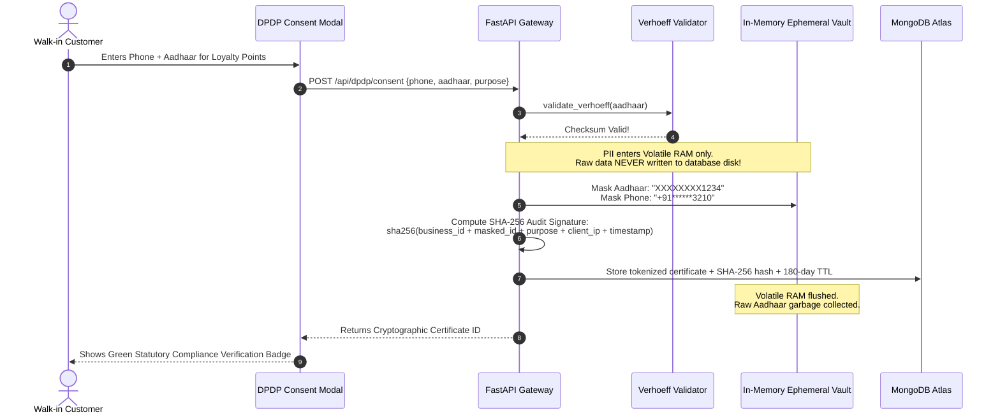

# 10. Security Architecture & Statutory DPDP Act 2023 Compliance

> **The Mentor's Note:** In system design interviews, security is where candidates get exposed. Most candidates say *"We use HTTPS and Bcrypt"*, and stop there.
> 
> In this guide, you will learn how we implemented the **Verhoeff Dihedral Group Checksum ($D_5$)**—the exact mathematical algorithm used by UIDAI to validate Indian Aadhaar numbers—and how we architected a **tamper-proof cryptographic consent vault** to protect MSMEs from ₹250 Crore statutory penalties under India's Digital Personal Data Protection Act (DPDP Act, 2023).

---

## 1. The Legal Threat: Why DPDP Act 2023 is a Massive Deal

In August 2023, the Indian Parliament enacted the **Digital Personal Data Protection Act, 2023**. 

Under this law:
- Any business that collects a customer's personal data (name, phone number, address, Aadhaar) is classified as a **Data Fiduciary**.
- If a business collects data without an **explicit, purpose-limited consent notice**, or fails to maintain verifiable audit trails, the Data Protection Board of India can impose statutory fines up to **₹250 Crore** (approx. \$30 Million USD).

### The MSME Nightmare:
Small salons, boutique clinics, and sweets shops collect phone numbers every day for walk-in appointments, loyalty points, or home delivery. 
- They scribble numbers in notebooks or save them in unencrypted phone contacts.
- If a disgruntled employee walks away with that notebook or a customer complains to the Data Protection Board, the business is legally defenseless.

FrameUp turned this terrifying legal liability into an **automated product trust badge**.

---

## 2. The Mathematical Beauty of the Verhoeff Checksum ($D_5$ Group)

When a customer inputs an Aadhaar number, a naive developer validates it with a regular expression: `^\d{12}$`.
Why is that dangerous?
A customer or clerk can type `1111 1111 1111` or accidentally swap two numbers (`12` instead of `21`). A regex accepts it, and our database is now filled with fraudulent, corrupted KYC records.

To prevent this, the Unique Identification Authority of India (UIDAI) mandated the **Verhoeff Algorithm**.

```
                   THE DIHEDRAL GROUP D5 SYMMETRY
                                  ^
                                 / \
                                /   \
                               /     \
                              /       \
                             +---------+
                 (The 10 symmetries of a regular pentagon:
                  5 rotations + 5 reflections)
```

### Why Luhn Algorithm (Mod 10) Fails:
The standard Luhn algorithm used on credit cards uses simple modulo 10 arithmetic. It fails to catch common human errors like:
- **Transposition errors:** Swapping adjacent digits ($ab \to ba$, like $78 \to 87$).
- **Twin errors:** Swapping twins ($aa \to bb$).

### Why Verhoeff ($D_5$) Succeeds:
Dutch mathematician Jacobus Verhoeff proved in 1969 that because decimal numbers are written in base 10, error detection must be performed over a **non-commutative group** of order 10. 
The simplest non-commutative group of order 10 is the **Dihedral Group $D_5$** (the geometric symmetries of a regular pentagon).

Because $D_5$ is non-commutative ($a \times b \neq b \times a$):
1. It detects **100% of all single-digit transcription errors** ($a \to b$).
2. It detects **100% of all adjacent transposition errors** ($ab \to ba$).
3. It detects **95.3% of twin errors** ($aa \to bb$).
4. It catches over **94% of all arbitrary multi-digit errors**.

---

## 3. The Production Python Implementation

Let's look at the mathematical matrices and Python implementation in `backend/app/routers/dpdp_gateway.py`:

```python
# backend/app/routers/dpdp_gateway.py (Production Implementation)

# The D5 multiplication matrix (10x10): Group multiplication of pentagon symmetries
_d = [
    [0, 1, 2, 3, 4, 5, 6, 7, 8, 9],
    [1, 2, 3, 4, 0, 6, 7, 8, 9, 5],
    [2, 3, 4, 0, 1, 7, 8, 9, 5, 6],
    [3, 4, 0, 1, 2, 8, 9, 5, 6, 7],
    [4, 0, 1, 2, 3, 9, 5, 6, 7, 8],
    [5, 9, 8, 7, 6, 0, 4, 3, 2, 1],
    [6, 5, 9, 8, 7, 1, 0, 4, 3, 2],
    [7, 6, 5, 9, 8, 2, 1, 0, 4, 3],
    [8, 7, 6, 5, 9, 3, 2, 1, 0, 4],
    [9, 8, 7, 6, 5, 4, 3, 2, 1, 0]
]

# The permutation matrix (8x10): Permutes digits based on their position from the right
_p = [
    [0, 1, 2, 3, 4, 5, 6, 7, 8, 9],
    [1, 5, 7, 6, 2, 8, 3, 0, 9, 4],
    [5, 8, 0, 3, 7, 9, 6, 1, 4, 2],
    [8, 9, 1, 6, 0, 4, 3, 5, 2, 7],
    [9, 4, 5, 3, 1, 2, 6, 8, 7, 0],
    [4, 2, 8, 6, 5, 7, 3, 9, 0, 1],
    [2, 7, 9, 3, 8, 0, 6, 4, 1, 5],
    [7, 0, 4, 6, 9, 1, 3, 2, 5, 8]
]

# The inverse matrix under D5
_inv = [0, 4, 3, 2, 1, 5, 6, 7, 8, 9]

def validate_verhoeff(number_str: str) -> bool:
    """
    Validates a number string (e.g. 12-digit Aadhaar) using Verhoeff algorithm.
    Time Complexity: O(n) where n = 12 (12 loop iterations).
    Space Complexity: O(1) (fixed matrix lookups).
    Returns True if valid checksum, False otherwise.
    """
    if not number_str or not number_str.isdigit():
        return False
        
    c = 0
    # Process digits in reverse order (right-to-left)
    reversed_digits = [int(x) for x in reversed(number_str)]
    
    for i, digit in enumerate(reversed_digits):
        # Look up multiplication in table _d using permuted index from _p
        c = _d[c][_p[i % 8][digit]]
        
    return c == 0
```

---

## 4. The Cryptographic Data Vault & Consent Lifecycle

When a walk-in customer registers their phone or Aadhaar at an MSME, how does our system handle it without storing raw personal data?



### The Key Security Guarantees:
1. **Zero Raw Aadhaar Persistence:** Even if our database cluster were completely compromised, an attacker would find zero 12-digit Aadhaar numbers. They would only find masked strings (`XXXXXXXX1234`).
2. **Tamper-Evident SHA-256 Ledger:** If a merchant tries to falsely claim a customer gave consent on a different date, the SHA-256 hash will not match the concatenated payload. It provides statutory legal proof.
3. **Automated Right-to-Erasure:** Every certificate has a 180-day TTL index. When the statutory retention period expires, MongoDB purges the record automatically.

---

## 5. How to Defend This in an Interview

### 🎤 The Interviewer's Question:
> *"How do you handle sensitive PII and compliance in FrameUp?"*

### 💡 Your Killer Answer:
> *"We designed our security architecture around the principles of **Data Minimization and Zero-Trust Storage** aligned with India's DPDP Act 2023.
> 
> When sensitive identifiers like Aadhaar numbers are submitted, we first validate their mathematical integrity using the **Verhoeff Dihedral Checksum ($D_5$)**. Because $D_5$ operates over non-commutative geometric symmetries, it detects 100% of single-digit and adjacent transposition errors in $O(n)$ time, preventing fraudulent identity records.
> 
> Once validated, the raw numbers are processed exclusively in volatile memory, permanently masked before disk persistence, and signed with an SHA-256 audit proof containing the client's IP, purpose, and timestamp. 
> 
> We store zero plaintext Aadhaar numbers on disk, and all consent documents are governed by MongoDB TTL indexes that automatically purge expired records, guaranteeing compliance with zero human error."*
