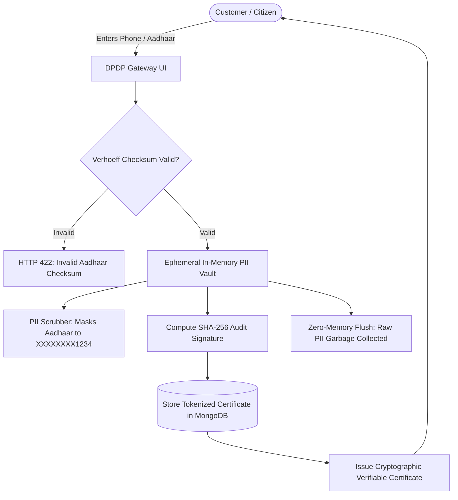

# 10. Security Architecture & DPDP Act 2023 Compliance

## 10. Security Architecture

### 10.1 Threat Modeling (STRIDE Analysis)

| Threat Category | Potential Attack Vector | FrameUp Architectural Defense |
| :--- | :--- | :--- |
| **Spoofing Identity** | Attacker attempts to forge JWT claims or session cookies. | Cryptographic signature verification using secret 256-bit entropy keys; tokens rejected upon single-bit alteration. |
| **Tampering with Data** | Attacker intercepts and modifies GST invoice totals or tax amounts. | Invariant server-side calculation of CGST/SGST/Total; client-supplied invoice totals are strictly ignored and recalculated. |
| **Repudiation** | Merchant or consumer denies granting consent for customer KYC/data collection. | Cryptographic DPDP certificate generation with SHA-256 hash of IP, timestamp, user-agent, and consent statement. |
| **Information Disclosure** | Customer telephone numbers, PAN, or Aadhaar numbers leaked via logs or APIs. | Automatic PII redaction pipeline; phone numbers masked (`+91******3210`); raw Aadhaar numbers never persisted. |
| **Denial of Service (DoS)**| Massive file upload floods or rapid LLM token draining calls. | Strict request body size limits ($10\text{MB}$ max payload) + Nginx ingress rate limiting + Token budgeting per tenant. |
| **Elevation of Privilege**| Standard merchant attempts to read other tenants' financial ledgers. | Multi-tenant scoping enforced at database query level (`find_one({"_id": id, "owner_id": current_user_id})`). |

---

### 10.2 The Mathematical Verhoeff Checksum Algorithm ($D_5$ Group)

The **Verhoeff Algorithm** is a checksum formula for error detection developed by Jacobus Verhoeff. Unlike the standard Luhn algorithm (mod 10), the Verhoeff algorithm utilizes the mathematical properties of the **Dihedral Group of order 10 ($D_5$)**, which represents the symmetries of a regular pentagon.

#### Why Verhoeff is Required for Aadhaar Validation:
The Unique Identification Authority of India (UIDAI) mandates that all 12-digit Aadhaar numbers utilize a Verhoeff checksum digit at the terminal position. The algorithm detects:
1. **100% of all single-digit transcription errors** ($a \to b$).
2. **100% of all adjacent transposition errors** ($ab \to ba$).
3. **95.3% of twin errors** ($aa \to bb$).
4. Over **94% of other jump transpositions** and arbitrary errors.

#### Group Tables ($D_5$ Multiplication, Inverses, & Permutation)
```python
# backend/app/routers/dpdp_gateway.py (Production Implementation)

_d = [
    [0, 1, 2, 3, 4, 5, 6, 7, 8, 9],
    [1, 2, 3, 4, 0, 6, 7, 8, 9, 5],
    [2, 3, 4, 0, 1, 7, 8, 9, 5, 6],
    [3, 4, 0, 1, 2, 8, 9, 5, 6, 7],
    [4, 0, 1, 2, 3, 9, 5, 6, 7, 8],
    [5, 9, 8, 7, 6, 0, 4, 3, 2, 1],
    [6, 5, 9, 8, 7, 1, 0, 4, 3, 2],
    [7, 6, 5, 9, 8, 2, 1, 0, 4, 3],
    [8, 7, 6, 5, 9, 3, 2, 1, 0, 4],
    [9, 8, 7, 6, 5, 4, 3, 2, 1, 0]
]

_p = [
    [0, 1, 2, 3, 4, 5, 6, 7, 8, 9],
    [1, 5, 7, 6, 2, 8, 3, 0, 9, 4],
    [5, 8, 0, 3, 7, 9, 6, 1, 4, 2],
    [8, 9, 1, 6, 0, 4, 3, 5, 2, 7],
    [9, 4, 5, 3, 1, 2, 6, 8, 7, 0],
    [4, 2, 8, 6, 5, 7, 3, 9, 0, 1],
    [2, 7, 9, 3, 8, 0, 6, 4, 1, 5],
    [7, 0, 4, 6, 9, 1, 3, 2, 5, 8]
]

_inv = [0, 4, 3, 2, 1, 5, 6, 7, 8, 9]

def validate_verhoeff(number_str: str) -> bool:
    """
    Validates a number string (e.g. 12-digit Aadhaar) using Verhoeff algorithm.
    Returns True if valid checksum, False otherwise.
    Time Complexity: O(n) where n is length of string (n=12).
    Space Complexity: O(1).
    """
    if not number_str.isdigit():
        return False
        
    c = 0
    reversed_digits = [int(x) for x in reversed(number_str)]
    for i, digit in enumerate(reversed_digits):
        c = _d[c][_p[i % 8][digit]]
        
    return c == 0
```

---

### 10.3 Statutory DPDP Compliance Architecture

Under the **Digital Personal Data Protection Act (DPDP Act 2023)**, data fiduciaries face non-compliance fines up to ₹250 Crore for processing personal identifiers without verifiable, purpose-limited consent.



#### Certificate Verification Proof Generation
```python
import hashlib
from datetime import datetime, timezone

def generate_dpdp_audit_proof(business_id: str, masked_id: str, purpose: str, client_ip: str) -> str:
    timestamp = datetime.now(timezone.utc).isoformat()
    raw_payload = f"{business_id}|{masked_id}|{purpose}|{client_ip}|{timestamp}"
    return hashlib.sha256(raw_payload.encode('utf-8')).hexdigest()
```

---

### 10.4 Authentication Token Lifecycle & Dual-Auth Hardening
- **Partitioned Cookies:** `SameSite=None` combined with `Secure=True` ensures seamless cookie persistence across cross-origin deployments (frontend on Vercel, backend on Render).
- **Session Expiration:** Hard 7-day token lifecycle prevents perpetual session hijacking.
- **CSRF Mitigation:** Strict CORS origin checks ensure state-changing POST/PUT requests cannot be triggered by external third-party origins.
