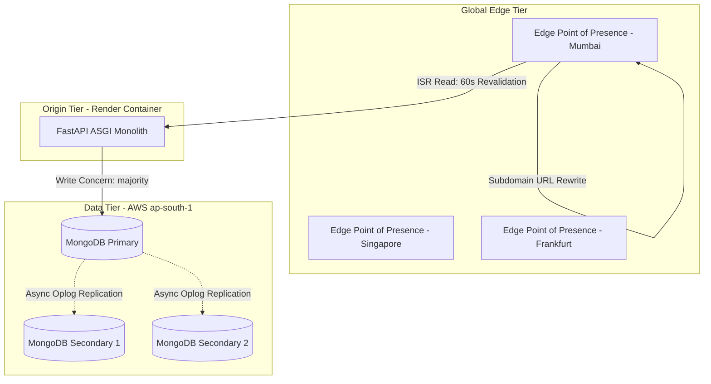

# 12. Distributed Systems & Cross-Tier Coordination

## 12. Distributed Systems Architecture

### 12.1 Cross-Tier Edge-to-Origin Coordination
FrameUp operates across three independent distributed tiers:
1. **Global Edge CDN (Vercel):** Runs edge middleware and React Server Component streaming across 300+ edge locations.
2. **Central Application Cluster (Render):** Runs ASGI container instances hosting FastAPI micro-monolith services.
3. **Managed Database Replica Set (MongoDB Atlas):** Primary-Secondary-Secondary (PSS) replica set in AWS Mumbai (`ap-south-1`).



---

### 12.2 Data Consistency Model & Eventual Consistency
- **Write Path:** Enforces Strong Consistency for financial, inventory, and authentication entities:
  - Write concern: `w: "majority"` ensures that writes are acknowledged by a quorum of replica set nodes before returning HTTP 201 to the client.
- **Read Path (Public Storefronts):** Operates under Eventual Consistency:
  - When a merchant updates their menu or hours, the write updates MongoDB immediately.
  - Vercel’s Edge CDN continues serving the cached ISR page for up to 60 seconds (`revalidate: 60`).
  - Next incoming visitor triggers a background stale-while-revalidate fetch, updating the edge cache transparently.

---

### 12.3 Idempotency & Distributed Transaction Safety

#### Invoicing & Inventory Deduplication
In emerging markets with fluctuating 4G networks, users frequently tap "Submit" multiple times when an API call appears sluggish. To prevent double billing or duplicate stock decrements:

```python
# backend/app/routers/invoices.py
async def issue_invoice(payload: InvoiceCreateRequest, business_id: str):
    # Enforce unique compound constraint on (business_id, idempotency_key)
    existing = await db.invoices.find_one({
        "business_id": ObjectId(business_id),
        "idempotency_key": payload.idempotency_key
    })
    if existing:
        return existing # Return existing invoice without duplicate charge
        
    async with await db.client.start_session() as session:
        async with session.start_transaction():
            # Decrement inventory and record invoice atomically
            await db.invoices.insert_one(payload.dict(), session=session)
            for item in payload.items:
                await db.inventory.update_one(
                    {"sku": item.sku, "business_id": ObjectId(business_id)},
                    {"$inc": {"quantity": -item.qty}},
                    session=session
                )
```

---

### 12.4 Network Partition & Split-Brain Mitigation
- MongoDB Atlas handles automated leader elections via Raft-like consensus. If the primary node becomes partitioned from the replica set, secondaries elect a new primary within 3 seconds.
- Motor driver's connection pool retries transactional writes automatically (`retryWrites=true`), masking transient primary elections from the end-user.
