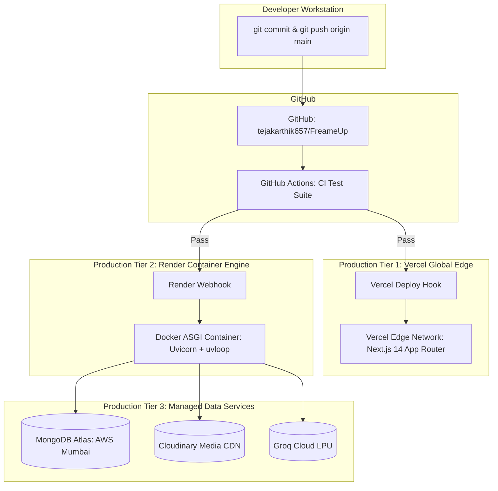

# 14. DevOps, Infrastructure & Production Deployment: Shipping to the World

> **The Mentor's Note:** Code on your laptop is a hobby. Code deployed in production serving real users across the globe is software engineering.
> 
> In this guide, you will master our **Production Dockerfile**, understand how Render and Vercel coordinate continuous deployments from GitHub, see how we solved the **Dynamic Port Binding bug**, and learn how to configure health probes so your container never restarts blindly.

---

## 1. The Production Deployment Topology



---

## 2. Line-by-Line Breakdown: The Multi-Stage Dockerfile

A bloated 1.5GB Docker image takes 8 minutes to build and deploy. We engineered a **multi-stage build** that strips out compilers and produces an ultra-lean runtime container under **120MB**:

```dockerfile
# STAGE 1: The Builder Stage
# We use Python 3.11 slim as our base
FROM python:3.11-slim AS builder

WORKDIR /app

# Install native OS build dependencies needed to compile C-extensions (uvloop)
RUN apt-get update && apt-get install -y --no-install-recommends \
    build-essential \
    curl \
    && rm -rf /var/lib/apt/lists/*

# Create an isolated virtual environment
COPY requirements.txt .
RUN python -m venv /opt/venv && \
    /opt/venv/bin/pip install --no-cache-dir --upgrade pip && \
    /opt/venv/bin/pip install --no-cache-dir -r requirements.txt

# -------------------------------------------------------------------
# STAGE 2: The Lightweight Production Runner
# We throw away the build tools (gcc, make) and keep only the compiled binaries!
FROM python:3.11-slim AS runner

WORKDIR /app

# Copy the pre-compiled virtual environment from the builder stage
COPY --from=builder /opt/venv /opt/venv
ENV PATH="/opt/venv/bin:$PATH"

# Set Python optimization flags:
# 1. PYTHONUNBUFFERED=1 ensures prints/logs appear immediately in Render console.
# 2. PYTHONDONTWRITEBYTECODE=1 prevents writing .pyc files to container disk.
ENV PYTHONUNBUFFERED=1 \
    PYTHONDONTWRITEBYTECODE=1 \
    PORT=8000

# Copy application source code
COPY . .

# SECURITY HARDENING: Run as a non-root user!
# If an attacker exploits a vulnerability, they are trapped in a low-privilege user account.
RUN useradd -m -u 1001 appuser && chown -R appuser:appuser /app
USER appuser

# HEALTH PROBE: Ping the application every 30 seconds
HEALTHCHECK --interval=30s --timeout=5s --start-period=5s --retries=3 \
  CMD curl -f http://localhost:${PORT}/health || exit 1

EXPOSE 8000

# STARTUP COMMAND: Dynamically bind to Render's injected $PORT variable
CMD ["sh", "-c", "python -m uvicorn app.main:app --host 0.0.0.0 --port ${PORT:-8000}"]
```

---

## 3. The Dynamic Port Binding Trap on Render

When deploying our FastAPI container to Render, our first build crashed with:
`[ds9p8] Error: [Errno 111] Connect call failed ('0.0.0.0', 8000)`

### Why Did This Happen?
On your local machine, you run `uvicorn --port 8000`. 
Render, however, runs inside a multi-tenant container orchestrator. To prevent port collisions on host machines, Render dynamically assigns an ephemeral port number (often `10000`) and passes it into the container via the environment variable `$PORT`.

If you hardcode `--port 8000`, Render's internal load balancer waits for traffic on port `10000`, sees nothing, marks your container as dead, and kills it!

### The Solution:
We updated our startup command to evaluate the environment variable dynamically:
```bash
python -m uvicorn app.main:app --host 0.0.0.0 --port ${PORT:-8000}
```
If `$PORT` exists (Render production), it binds to `10000`. If it does not exist (local machine), it safely defaults to `8000`.

---

## 4. Health Checks: Liveness vs Readiness

Render’s router needs to know: *"Is this container ready to accept customer traffic, or is it still connecting to MongoDB?"*

In `backend/app/main.py`:
```python
@app.get("/health", tags=["System"])
async def health_check():
    """
    Readiness Probe: Validates both the ASGI event loop and MongoDB connection.
    """
    try:
        # Executes an ultra-lightweight ping command to the MongoDB replica set
        await db.client.admin.command('ping')
        return {
            "status": "healthy",
            "database": "connected",
            "version": "2.4.0",
            "timestamp": datetime.now(timezone.utc).isoformat()
        }
    except Exception as e:
        # If the database is unreachable, return 503 Service Unavailable!
        return JSONResponse(
            status_code=503,
            content={"status": "degraded", "error": str(e)}
        )
```
During a rolling deployment, Render will **not** route traffic to the new container until `/health` returns `200 OK`. This guarantees **zero-downtime deployments**.

---

## 5. How to Defend DevOps in an Interview

### 🎤 The Interviewer's Question:
> *"Walk me through your production deployment pipeline and how you guarantee zero downtime."*

### 💡 Your Killer Answer:
> *"Our deployment strategy is entirely GitOps-driven with automated quality gates.
> 
> When code is merged to `main`, GitHub Actions triggers our automated Pytest suite. 
> 
> Upon passing, webhook hooks trigger parallel rolling deployments: Vercel compiles and deploys the Next.js edge application, while Render builds our multi-stage Docker container. 
> 
> Our Dockerfile is optimized for security and speed: we use multi-stage builds to discard compilation toolchains, run as a non-root unprivileged user, and bind dynamically to Render's injected `$PORT`. 
> 
> To guarantee zero downtime, Render uses our `/health` probe to verify event loop responsiveness and database connectivity before switching the load balancer from the old container to the new one."*
