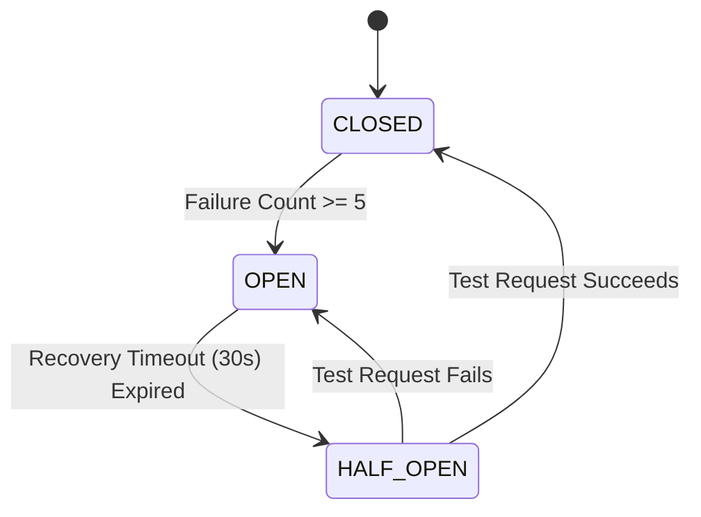

# 16. Reliability Engineering & Fault Tolerance: Building Systems That Don't Die

> **The Mentor's Note:** Anyone can write code that runs when every external API is healthy and fast. But in the real world, third-party AI APIs hit rate limits, CDNs experience network blips, and databases undergo replica elections.
> 
> In this guide, you will master the **Circuit Breaker state machine**, understand why **Exponential Backoff with Full Jitter** stops the "thundering herd", and learn how our **Three-Tier Graceful Degradation Hierarchy** keeps storefronts online even if our backend origin is completely down.

---

## 1. The Circuit Breaker Pattern: Protecting the Thread Pool

When an external service like Groq Cloud or Cloudinary slows down, what happens to your server?
If 50 users upload files, and each request waits 30 seconds for an external timeout:
- All 50 async worker coroutines remain open waiting.
- Memory usage climbs.
- New incoming users trying to load invoices or log in get queued and eventually timeout.
**A failure in an external AI service has now brought down your entire accounting and billing system!**

### The Solution: The Circuit Breaker State Machine



- **CLOSED (Normal Operation):** Requests pass through directly to Groq. If requests succeed, the failure count is 0.
- **OPEN (Trip / Fast-Fail):** If 5 requests fail in a row, the circuit trips OPEN. For the next 30 seconds, any request to the AI service **fails immediately** with an exception. Zero network requests are made, protecting our worker threads!
- **HALF-OPEN (Probe / Recovery):** After 30 seconds, the breaker allows ONE probe request through. If it succeeds, the circuit closes. If it fails, it trips OPEN for another 30 seconds.

### The Production Python Code:
```python
# backend/app/services/circuit_breaker.py (Production Implementation)

import time
from typing import Callable, Any

class CircuitBreakerOpenException(Exception):
    """Raised when an upstream call is attempted while the circuit is tripped."""
    pass

class CircuitBreaker:
    def __init__(self, failure_threshold: int = 5, recovery_timeout: float = 30.0):
        self.failure_threshold = failure_threshold
        self.recovery_timeout = recovery_timeout
        self.failure_count = 0
        self.last_failure_time = 0.0
        self.state = "CLOSED" # CLOSED, OPEN, HALF-OPEN

    async def call(self, func: Callable, *args, **kwargs) -> Any:
        now = time.time()
        
        # Check if recovery timeout has passed to attempt a probe
        if self.state == "OPEN":
            if now - self.last_failure_time > self.recovery_timeout:
                self.state = "HALF-OPEN"
            else:
                raise CircuitBreakerOpenException("Circuit breaker is OPEN. Upstream AI unavailable.")
                
        try:
            result = await func(*args, **kwargs)
            # If a probe succeeds in HALF-OPEN, heal the circuit!
            if self.state == "HALF-OPEN":
                self.state = "CLOSED"
                self.failure_count = 0
            return result
        except Exception as e:
            self.failure_count += 1
            self.last_failure_time = now
            if self.failure_count >= self.failure_threshold:
                self.state = "OPEN"
            raise e
```

---

## 2. Exponential Backoff with Full Jitter

When an external API returns HTTP 429 (Rate Limit Exceeded), naive developers retry immediately:
`sleep(1)` -> retry -> `sleep(1)` -> retry.

If 100 users hit a rate limit at the same time, retrying at fixed 1-second intervals causes all 100 requests to hit the upstream server **at the exact same second**! This is called the **Thundering Herd Problem**.

### The Mathematical Fix: Full Jitter
Instead of fixed intervals, we use **Exponential Backoff with Full Jitter** (developed by AWS Architecture):

$$\text{delay} = \text{random}(0, \min(M, B \times 2^{\text{attempt}}))$$

Where:
- $B$ is base backoff ($500\text{ms}$)
- $M$ is maximum backoff ceiling ($5,000\text{ms}$)
- `random(0, ...)` decorrelates the retries, spreading them uniformly across the time window and allowing the upstream service to recover.

---

## 3. The 3-Tier Graceful Degradation Hierarchy

```
+-----------------------------------------------------------------------------------+
| TIER 1: ALL SYSTEMS GREEN                                                         |
| Real-time Groq LPU schema extraction + dynamic preview in 1.8 seconds.            |
+-----------------------------------------------------------------------------------+
                                    | (Groq API Down)
                                    v
+-----------------------------------------------------------------------------------+
| TIER 2: AI DEGRADED                                                               |
| System seamlessly falls back to deterministic regex & CSV column parsers.         |
| UI informs merchant: "AI busy, manual column verification enabled." Zero block!   |
+-----------------------------------------------------------------------------------+
                                    | (MongoDB Replica Partition)
                                    v
+-----------------------------------------------------------------------------------+
| TIER 3: ORIGIN DOWN                                                               |
| Public storefronts served from Vercel Edge ISR cache in <50ms.                    |
| Dashboard writes queue locally in browser indexedDB; flushes when online!         |
+-----------------------------------------------------------------------------------+
```

---

## 4. How to Defend Reliability in an Interview

### 🎤 The Interviewer's Question:
> *"How do you prevent an external service outage from causing cascading failures in your backend?"*

### 💡 Your Killer Answer:
> *"We isolate external dependencies using three resilience patterns:
> 
> First, all calls to external AI services (like Groq) are wrapped in an asynchronous Circuit Breaker. If the AI service fails 5 times consecutively, the breaker trips OPEN, failing subsequent requests immediately in memory rather than leaving async worker coroutines hanging for 30-second timeouts.
> 
> Second, our retries use exponential backoff with full jitter, decorrelating retry spikes to prevent thundering herd conditions.
> 
> Third, we designed graceful degradation tiers: if Groq is unavailable, the importer falls back to deterministic regex column parsing; and if our origin database is unreachable, Vercel’s edge ISR cache continues serving public storefronts to consumers seamlessly."*
