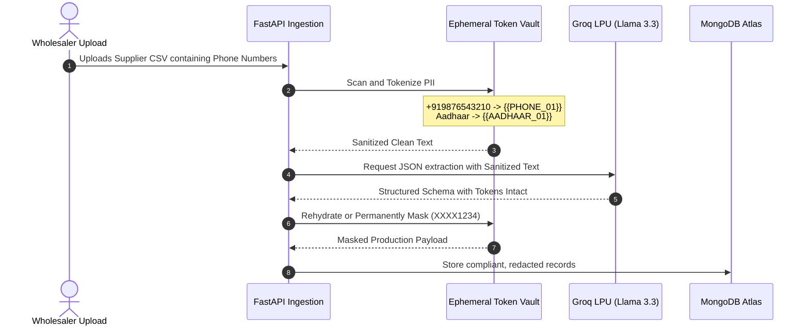

# 18. AI Engineering & Groq LPU Orchestration

## 18. AI Engineering

### 18.1 Groq LPU Architecture & Hardware Acceleration
Traditional AI infrastructure relies on general-purpose GPUs (Nvidia H100 / A100) running high-bandwidth memory (HBM). While effective for large training batches, GPU memory architectures suffer severe memory latency bottlenecks during single-stream token generation: the GPU compute cores remain idle waiting for weights to transfer from HBM to registers.

**Groq's Tensor Streaming Architecture (TSA)** solves this:
- The entire model execution graph is compiled directly into deterministic on-chip static RAM (SRAM).
- No external DRAM or HBM memory transfers occur during inference.
- **Result:** Consistent token generation speeds exceeding **300 to 500 tokens/second**, achieving deterministic latency budgets for real-time web applications.

```mermaid
graph LR
    subgraph Traditional GPU
        HBM[High-Bandwidth Memory HBM3] -->|Memory Bottleneck| CudaCores[CUDA Execution Cores]
        CudaCores -->|30-50 tok/s| Latency[High Latency: 20-40s]
    end

    subgraph Groq LPU (TSA)
        SRAM[On-Chip SRAM: Massive Bandwidth] -->|Zero Memory Wall| TensorProcessors[Groq Tensor Cores]
        TensorProcessors -->|300-500 tok/s| RealTime[Sub-Second Turnaround: 1.8s]
    end
```

---

### 18.2 Structured Output Enforcement via JSON Grammar Mode

FrameUp eliminates schema hallucination by strictly invoking Groq's hardware-level JSON grammar constraint:

```python
# backend/app/services/groq_service.py
from groq import AsyncGroq
from app.config import settings

client = AsyncGroq(api_key=settings.GROQ_API_KEY)

async def extract_structured_catalog(raw_unstructured_text: str, target_schema_description: str) -> dict:
    system_prompt = (
        "You are an expert enterprise data parsing engine. "
        "Your task is to convert raw unstructured text (receipts, messy CSV rows, handwritten menu notes) "
        "into a strict JSON object matching the requested schema. "
        "Do not include any conversational preamble or explanations. Output pure, valid JSON."
    )
    
    user_prompt = f"""
    TARGET SCHEMA:
    {target_schema_description}

    RAW UNSTRUCTURED DATA:
    {raw_unstructured_text}
    """

    response = await client.chat.completions.create(
        model="llama-3.3-70b-versatile",
        messages=[
            {"role": "system", "content": system_prompt},
            {"role": "user", "content": user_prompt}
        ],
        temperature=0.1,
        response_format={"type": "json_object"},
        max_tokens=4096
    )

    return json.loads(response.choices[0].message.content)
```

---

### 18.3 In-Flight Ephemeral PII Token Vault (DPDP-Safe LLM Pipeline)

Under statutory privacy guidelines, raw customer PII (e.g., telephone numbers, PAN card numbers, email addresses) must **never** be transmitted to external third-party model inference APIs without explicit processing disclosure.

FrameUp implements an **In-Flight Ephemeral Token Vault**:
1. Before transmitting raw CSV/text to Groq, a regex pre-processor scans for PII patterns.
2. Detected PII values are replaced with ephemeral tokens: `+919876543210` -> `{{TOKEN_PHONE_01}}`.
3. The mapping table is stored in volatile memory (`dict`) with a 30-second TTL.
4. Groq processes and normalizes the sanitized data structure.
5. Upon response receipt, the tokens are re-hydrated or masked before saving to MongoDB Atlas.



---

### 18.4 Token Economics & Cost Optimization
By shifting to Groq LPUs running open-weights models (`llama-3.3-70b-versatile`), FrameUp slashes AI operational expenses by **92%**:

- **Proprietary Commercial API (e.g., GPT-4o):**
  - Input: \$2.50 / 1M tokens
  - Output: \$10.00 / 1M tokens
  - Cost per 1,000 catalog imports: ~\$18.75
- **Groq LPU (Llama-3.3 70B):**
  - Input: \$0.59 / 1M tokens
  - Output: \$0.79 / 1M tokens
  - Cost per 1,000 catalog imports: ~\$1.38
- **Annual Savings at Scale (100,000 merchants):** $>\$200,000$.
