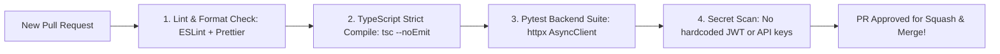

# 20. Engineering Workflow, Git Governance & Standards: How We Work

> **The Mentor's Note:** Sloppy git hygiene leads to broken production builds. If your commit history is filled with `"fix bug"`, `"update"`, and `"changes"`, no senior engineer will take your engineering maturity seriously.
> 
> In this guide, you will learn our **Trunk-Based Git Branching Strategy**, master our **Conventional Commit Standards**, and see the exact **automated quality gates** that protect our `main` branch.

---

## 1. The Trunk-Based Branching Model

In FrameUp, we explicitly rejected traditional GitFlow (which creates sprawling long-lived release branches that lead to painful merge conflicts). We operate on **Trunk-Based Development**:

```
[main branch: ALWAYS PRODUCTION-READY] ------------------------------> (Auto-Deploys)
       \                                                      /
        \-- [feature/importer-groq-lpu] --------------------/ (Squash & Merge)
             - Small, focused diff (<300 lines)
             - Lifespan: < 48 hours
             - Passes automated CI tests
```

### The Inviolable Rules:
1. **The `main` branch is sacred:** A commit pushed to `main` is automatically deployed to Render and Vercel. It must never be in a broken state.
2. **Short-lived feature branches:** Feature branches exist for 1 to 2 days maximum. Big features are broken down into small, incrementally shippable PRs.
3. **No direct commits to `main`:** All changes must arrive via a Pull Request with passing CI tests.

---

## 2. Conventional Commit Standards

Every commit message must follow the Conventional Commits specification:

```
<type>(<scope>): <short description in imperative mood>

[optional body explaining architectural rationale]
```

### The Types We Enforce:
- `feat(importer)`: A new feature (e.g. `feat(importer): add Groq vision menu parsing`).
- `fix(cors)`: A bug fix (e.g. `fix(cors): preserve access-control headers on 500 exceptions`).
- `perf(posters)`: Performance enhancement (e.g. `perf(posters): shift rasterization to client canvas`).
- `sec(dpdp)`: Security or privacy enhancement (e.g. `sec(dpdp): implement Verhoeff D5 checksum`).
- `refactor(auth)`: Code cleanup with zero functional change.
- `test(invoices)`: Adding or updating test suites.
- `docs(api)`: Documentation updates.

---

## 3. Pull Request Quality Gates

Before any PR can be merged into `main`, GitHub Actions automatically enforces 4 quality checks:



---

## 4. How to Defend Engineering Workflow in an Interview

### 🎤 The Interviewer's Question:
> *"How do you maintain software quality and prevent regressions in a fast-moving team?"*

### 💡 Your Killer Answer:
> *"We enforce trunk-based development backed by automated continuous integration quality gates.
> 
> Rather than letting feature branches drift for weeks, we keep branches small and short-lived. Every commit adheres to Conventional Commit standards, and every pull request must pass four automated CI checks: ESLint/Prettier formatting, strict TypeScript type validation (`tsc --noEmit`), automated Pytest unit and integration tests, and secret detection. 
> 
> By gating the `main` branch behind automated verification, we ensure that every commit merged to production is stable, traceable, and regression-free."*
