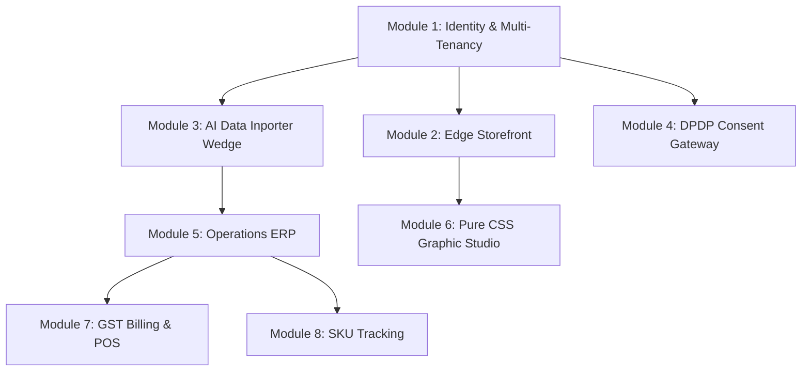

# Phase 1 — Product & Requirements Engineering
## System: FrameUp (DevFrames Enterprise MSME Operating System)

> **Architect's Orientation:** This document covers the foundational phase of software engineering: **understanding what to build before writing a single line of code**. We map the business chaos of 63 million Indian MSMEs into formal product vision, functional invariants, domain models, feature specifications, and UX interaction designs.

---

## 1. Product Engineering

### 1.1 Product Vision
To build a zero-maintenance, edge-accelerated, single-pane-of-glass operating system that empowers Indian Micro, Small, and Medium Enterprises (MSMEs) to establish a digital presence, ingest messy real-world data, maintain statutory legal compliance, and manage daily store operations—at **₹0 baseline recurring infrastructure cost**.

### 1.2 Target Users & Market Reality
In India, MSMEs contribute over 30% of national GDP, yet over 92% lack formal digital systems. The target users operate in three core verticals:
1. **Boutique Restaurants & Cloud Kitchens:** High item turnover, daily menu modifications, regional language dishes, heavy dependency on 30% aggregator commissions (Swiggy/Zomato).
2. **Unisex Salons & Wellness Spas:** Service packages, stylist tiers, walk-in customer booking, sensitive telephone records, vulnerable to DPDP compliance audits.
3. **Automotive Spare Parts & Local Trade:** Corrupted vendor invoices, non-standard SKU descriptions, tiered wholesale pricing, multi-bracket GST tax accounting.

### 1.3 Core Value Proposition
- **Time-to-Value:** From signup to a live, edge-cached, mobile-optimized storefront in under **60 seconds**.
- **Financial Freedom:** Replaces a fragmented ₹35,000–₹1,50,000/month software subscription stack (Shopify + Canva + Flatfile + Tally) with an all-in-one platform running on lightweight cloud tiers.
- **Turnkey Statutory Protection:** Full compliance with the Digital Personal Data Protection (DPDP) Act 2023 out of the box with verifiable cryptographic proof.

### 1.4 Business Requirements
- **BR-1 (Compute Cost Frugality):** The architecture must support thousands of merchant tenants without requiring dedicated server dynos per tenant.
- **BR-2 (Mobile Hardware Tolerance):** The client interface must run seamlessly on budget Android smartphones (2GB–4GB RAM) on fluctuating 4G networks.
- **BR-3 (Zero Merchant Training):** Merchants must not be required to learn spreadsheet formulas, DNS terminology, or design tools.

---

## 2. Requirements Engineering

### 2.1 Functional Requirements (FR)
- **FR-01 (Multi-Tenant Authentication):** User registration and authentication via Email/Password or Google OAuth2 with secure dual session management (HTTP-Only partitioned cookie `devframes_token` + `Authorization: Bearer` fallback).
- **FR-02 (Instant Edge Subdomain Storefront):** Dynamic URL resolution routing `<slug>.frameup.in` to `/site/[slug]` at the edge without manual DNS propagation.
- **FR-03 (Unstructured AI Data Ingestion):** Ingestion of phone photos (menus, handwritten bills) and unformatted CSV/TSV files with automated semantic column mapping in under 2 seconds.
- **FR-04 (Statutory DPDP Consent Gateway):** Capturing explicit, purpose-limited consent; validating 12-digit Aadhaar identifiers via the **Verhoeff Dihedral ($D_5$) Checksum**; masking PII in persistent storage; emitting SHA-256 audit certificates.
- **FR-05 (Zero-Server-Compute Graphic Studio):** Synthesizing merchant branding and promotional discounts into 18 pure CSS templates rasterized into 300 DPI PNGs on the client GPU via HTML5 Canvas.
- **FR-06 (GST Compliant Invoicing):** Multi-tier GST calculation (CGST + SGST for intra-state, IGST for inter-state), invoice number generation, and downloadable PDF bills.
- **FR-07 (Real-Time Inventory Ledger):** SKU stock level tracking with automated reorder threshold alerts and atomic decrement upon invoice generation.
- **FR-08 (Geospatial Catchment Radar):** Free-tier reverse geocoding and competitor density calculation using OpenStreetMap and CARTO vector tiles.

### 2.2 Non-Functional Requirements (NFR)
- **NFR-P1 (Edge TTFB):** Storefront Time-to-First-Byte must be $\le 180\text{ms}$ globally.
- **NFR-P2 (API Latency):** Backend API p95 response time must be $\le 75\text{ms}$ for standard CRUD operations.
- **NFR-P3 (Inference Speed):** AI structured extraction must exceed $280\text{ tokens/sec}$ using Groq LPUs.
- **NFR-S1 (Cryptographic Hardening):** Passwords hashed with `bcrypt` (work factor $\ge 12$); JWTs signed via HS256 with 256-bit entropy keys.
- **NFR-A1 (Availability):** Public storefront edge endpoints must maintain 99.9% uptime.

### 2.3 User Stories & Acceptance Criteria
- **User Story 1 (Restaurant Menu Onboarding):**
  - *As a* sweet shop owner in Lucknow,
  - *I want to* upload a phone camera photo of my handwritten paper menu,
  - *So that* my dishes, prices, and categories appear on my live website without typing them manually.
  - *Acceptance Criteria:* Ingestion turnaround $< 3\text{ seconds}$; extraction accuracy $\ge 98\%$; menu immediately visible at `<slug>.frameup.in`.

- **User Story 2 (Walk-In Customer KYC):**
  - *As a* salon owner in Bangalore,
  - *I want to* collect customer phone numbers with verifiable consent,
  - *So that* I am immune to ₹250 Crore penalties under the DPDP Act 2023.
  - *Acceptance Criteria:* Aadhaar verified mathematically via Verhoeff $D_5$; phone masked (`+91******3210`); SHA-256 certificate issued.

---

## 3. Domain Modeling

### 3.1 Business Entities & Bounded Contexts
FrameUp is partitioned into four explicit domain contexts:
1. **Identity & Tenancy Context:** `User`, `Business`, `TenantCredentials`, `Role`.
2. **Storefront & Presentation Context:** `Website`, `Theme`, `MenuSection`, `ServiceItem`, `PosterManifest`.
3. **Operations & Finance Context:** `Invoice`, `TaxBracket`, `InventorySKU`, `Supplier`, `StaffMember`.
4. **Compliance & Privacy Context:** `ConsentRecord`, `DataVaultToken`, `AuditCertificate`, `ErasureRequest`.

### 3.2 Domain Model Relationships
```
[ User (Owner) ] 1 ===== * [ Business (Tenant Anchor) ]
                                |
        +-----------------------+-----------------------+
        | 1:1                   | 1:N                   | 1:N
        v                       v                       v
   [ Website ]             [ Invoices ]           [ InventorySKU ]
   - Theme tokens          - CGST / SGST split    - Stock on hand
   - Menu sections         - Customer PII token   - Reorder threshold
   - Business hours        - Payment status       - Supplier link
```

---

## 4. Product & Feature Specification

### 4.1 Module Breakdown & Dependencies


### 4.2 Feature Prioritization Matrix (MoSCoW)
- **Must Have (v2.4.0):** Edge subdomain routing, Groq LPU data extraction, DPDP Verhoeff validator, pure CSS poster export, GST invoicing.
- **Should Have:** Vernacular localization switcher, dynamic UPI QR codes, stock threshold email alerts.
- **Could Have:** Automated WhatsApp catalog sync bot, multi-warehouse stock transfer.
- **Won't Have (Deferred):** Third-party payment escrow gateways (to avoid 2% transaction take rates).

---

## 5. UX Research & Interaction Design

### 5.1 The 60-Second Mobile Onboarding Workflow
```
[ Screen 1: Business Identity ]
User inputs "Saffron Bistro" + Selects "Restaurant" (10s)
               |
               v
[ Screen 2: Paper Menu Photo Capture ]
Camera opens -> User snaps photo of physical menu -> Uploads (15s)
               |
               v
[ Background: Groq LPU Execution ]
Streaming inference extracts 45 dishes into JSON (1.8s)
               |
               v
[ Screen 3: Review & Palette Selection ]
User sees extracted items, selects "Emerald Minimal" theme (15s)
               |
               v
[ Screen 4: Storefront Live! ]
Live link "saffron-bistro.frameup.in" ready to share on WhatsApp (2s)
```

### 5.2 Accessibility & Usability Invariants
- **High Contrast Dark Mode:** Charcoal `#09090B` base with high-contrast `#FAFAFA` typography ensures legibility under direct sunlight in roadside open-air shops.
- **Touch Targets:** Minimum $48\text{px} \times 48\text{px}$ touch zones on all actionable buttons for one-handed operation.
- **Zero Form Clutter:** Form fields auto-capitalize and format phone numbers with `+91` prefix automatically.
