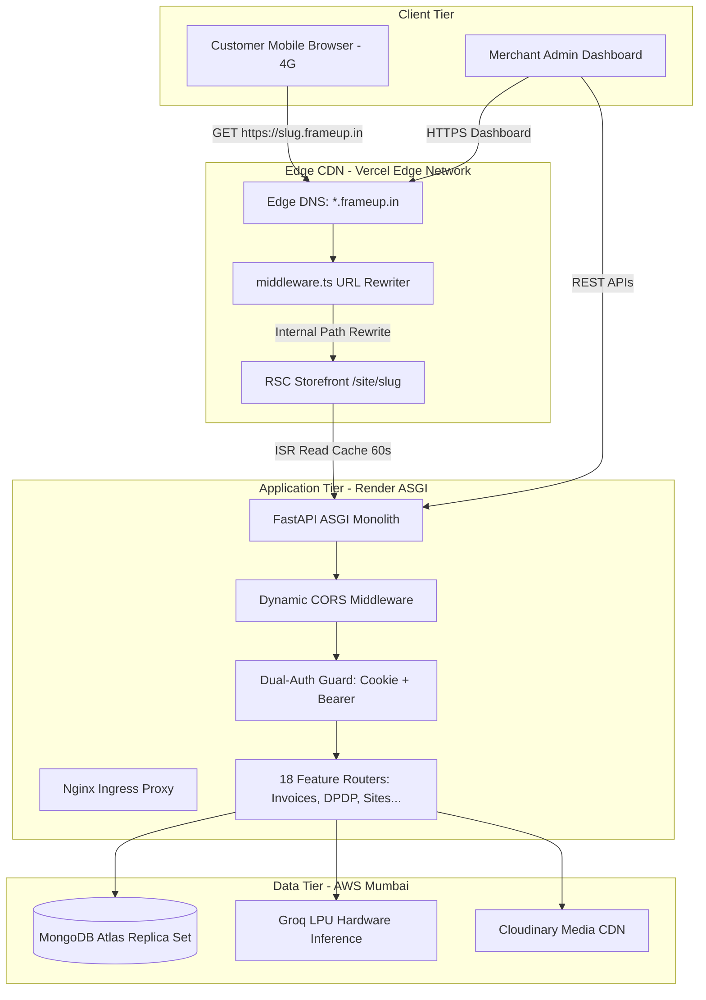
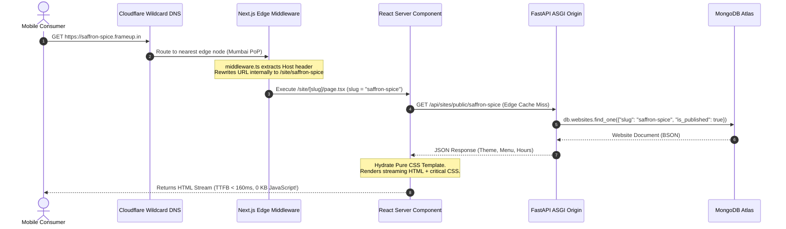

# Phase 2 — Architecture & System Design
## System: FrameUp (DevFrames Enterprise MSME Operating System)

> **Architect's Orientation:** This document determines **how the entire application is structured**. We break down the software architecture, high-level and low-level system designs, component boundaries, distributed cross-tier consistency, end-to-end data flows, and global infrastructure topology.

---

## 6. Software Architecture

### 6.1 Architectural Pattern: The Decoupled Edge Micro-Monolith
Rather than decomposing prematurely into distributed microservices connected via gRPC—which introduces network serialization overhead, distributed transactions (Saga / 2PC), and high container hosting costs—FrameUp is engineered as a **Decoupled Edge Micro-Monolith**:

```
+-----------------------------------------------------------------------------------+
|                        THE DECOUPLED EDGE MICRO-MONOLITH                          |
+-----------------------------------------------------------------------------------+
| 1. EDGE PRESENTATION TIER (Next.js 14 App Router on Vercel Edge)                  |
|    - Edge Middleware (middleware.ts): Wildcard subdomain routing (<slug>.frameup) |
|    - React Server Components (RSC): Zero client JavaScript shipped to visitors    |
|    - Incremental Static Regeneration (ISR): 60-second edge caching layer          |
+-----------------------------------------------------------------------------------+
| 2. ASYNC CORE TIER (FastAPI ASGI on Render Linux Container)                       |
|    - Modular Monolith: 18 cohesive feature routers in one process                 |
|    - uvloop: C-based event loop delivering 10,000+ non-blocking I/O connections    |
|    - Thin Controllers -> Domain Services -> Non-blocking Motor Database Access    |
+-----------------------------------------------------------------------------------+
| 3. PERSISTENCE & ACCELERATION (Managed Cloud Infrastructure)                      |
|    - MongoDB Atlas Replica Set (AWS Mumbai): Polymorphic BSON document models    |
|    - Groq Cloud LPU Cluster: Hardware SRAM tensor streaming (300+ tok/s)          |
+-----------------------------------------------------------------------------------+
```

### 6.2 Layered & Clean Architecture Boundaries
Within the Python backend (`backend/app/`), strict clean architecture boundaries are enforced:
- **Presentation / Transport Layer (`routers/`):** Thin HTTP controllers. Validates request schemas using Pydantic, extracts authentication principals, calls domain services, and returns serialized responses.
- **Service Layer (`services/`):** Pure business logic. Contains the Verhoeff checksum algorithm, fuzzy column mapping, Groq prompt grammar formatting, and GST tax calculations. Zero direct dependency on HTTP request objects.
- **Persistence Layer (`database.py`):** Encapsulates non-blocking Motor queries, transaction sessions, and compound indexing initialization.

---

## 7. System Design (HLD & LLD)

### 7.1 High-Level Design (HLD)


### 7.2 Low-Level Design (LLD): The Dual-Auth Security Guard
```python
# backend/app/routers/auth.py
async def get_current_user_id(
    request: Request,
    authorization: Optional[str] = Header(None)
) -> str:
    token = None
    # Priority 1: XSS-safe HTTP-Only partitioned cookie
    cookie_token = request.cookies.get("devframes_token")
    if cookie_token:
        token = cookie_token
    # Priority 2: Fallback for mobile apps & cross-origin tracking suppression
    elif authorization and authorization.startswith("Bearer "):
        token = authorization.split(" ")[1]
        
    if not token:
        raise HTTPException(status_code=401, detail="Authentication credentials missing.")
        
    payload = jwt.decode(token, settings.JWT_SECRET, algorithms=[settings.JWT_ALGORITHM])
    return payload.get("sub")
```

---

## 8. Component & Module Architecture

### 8.1 Module Boundaries & Interface Contracts
The system exposes 18 modular feature boundaries under `backend/app/routers/`:

```
+--------------------+---------------------------------------------------------------+
| Module Name        | Interface Contract & Responsibility                           |
+--------------------+---------------------------------------------------------------+
| auth & auth_google | Issue & verify JWTs, Google OAuth2 callback, set cookies      |
| sites              | Storefront CRUD, live theme customizer, public edge endpoint  |
| importer           | Multipart file upload, Groq LPU column mapping, batch commits  |
| dpdp_gateway       | Verhoeff D5 check, in-memory PII vault, SHA-256 audit proofs  |
| invoices           | Tax invoice issuance, multi-tax GST math, stock auto-decrement|
| inventory          | SKU tracking, threshold triggers, stock adjustment ledgers    |
| posters            | 18 pure CSS poster manifests, client DOM export bridge        |
| qr                 | Dynamic UPI payment QR codes & contact vCards                 |
| localization       | Vernacular script translation & Lakh/Crore currency formatting|
+--------------------+---------------------------------------------------------------+
```

---

## 9. Distributed Systems Design

### 9.1 Cross-Tier Consistency Model
- **Public Storefronts (Eventual Consistency):** Next.js Incremental Static Regeneration (ISR) caches HTML storefronts at the edge for 60 seconds (`revalidate: 60`). When a merchant changes a price, the update propagates globally within 60 seconds while serving edge reads in **<45ms**.
- **Financial & Stock Ledgers (Strong Consistency):** Invoices and inventory deductions are written with MongoDB write concern `w: "majority"` inside ACID session transactions (`db.client.start_session()`).

### 9.2 Distributed Idempotency Engine
To prevent duplicate billing when cashiers tap "Charge" multiple times on fluctuating mobile connections:
1. Client generates a unique UUID transaction key: `idempotency_key`.
2. Backend checks `db.invoices.find_one({"business_id": b_id, "idempotency_key": key})`.
3. If found, returns existing invoice immediately with **zero duplicate charges and zero double-stock decrements**.

---

## 10. Data Flow Architecture

### 10.1 End-to-End Storefront Read Lifecycle


---

## 11. Infrastructure Architecture

### 11.1 Cloud Environments & Multi-Cloud Footprint
- **Edge Layer:** Vercel Global Edge Network (Node.js & V8 Edge Runtime).
- **Application Layer:** Render Cloud Services (Linux Docker Container running Python 3.11 ASGI).
- **Data Layer:** MongoDB Atlas (AWS Mumbai `ap-south-1` 3-node replica set).
- **Inference Layer:** Groq Cloud LPU Hardware Cluster.
- **Media CDN:** Cloudinary Global Media Delivery Network.

### 11.2 Environment Isolation Matrix
```
+------------------+------------------------------+------------------------------+
| Environment      | Frontend Origin              | Backend Origin               |
+------------------+------------------------------+------------------------------+
| Local Dev        | http://localhost:3000        | http://localhost:8000        |
| Subdomain Local  | http://*.localhost:3000      | http://localhost:8000        |
| Production       | https://frameup.in           | https://freameup.onrender.com|
| Edge Subdomains  | https://*.frameup.in         | https://freameup.onrender.com|
+------------------+------------------------------+------------------------------+
```
