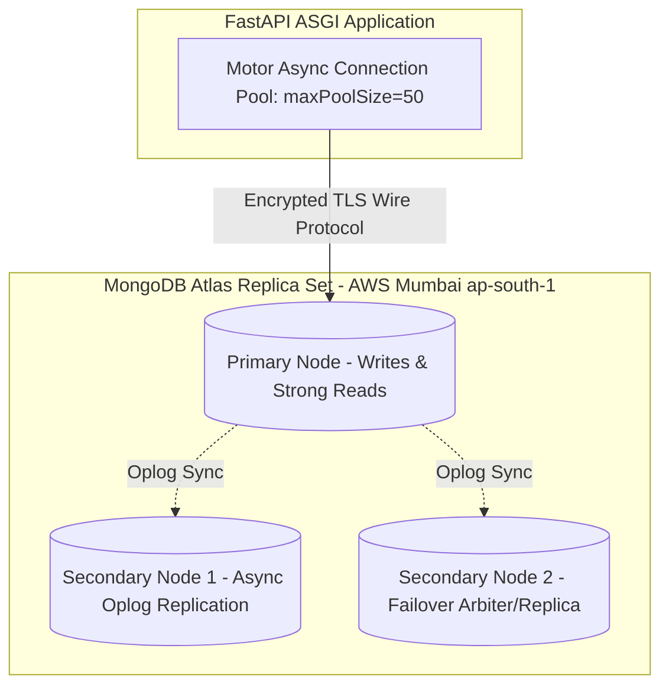
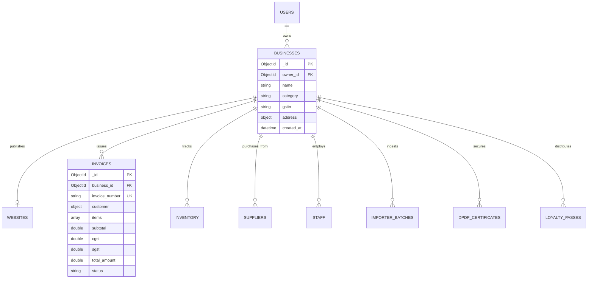

# Phase 5 — Database & Data Engineering
## System: FrameUp (DevFrames Enterprise MSME Operating System)

> **Architect's Orientation:** This document details **how information is structured, stored, queried, and maintained**. We cover MongoDB Atlas replica sets, polymorphic document modeling, compound B-Tree indexes, aggregation pipelines, ACID transactions, TTL-driven DPDP data lifecycle purging, and sharding strategies.

---

## 26. Database Architecture

### 26.1 Database Choice: MongoDB Atlas vs PostgreSQL
- **The Polymorphic Dilemma:** An MSME platform must simultaneously store restaurants (menus, dietary tags, spice levels), salons (stylists, durations, package bundles), and mechanics (part numbers, OEM compatibility). 
- In relational SQL (PostgreSQL), normalizing this requires either an Entity-Attribute-Value (EAV) anti-pattern or 35+ tables with 6-way joins to render a simple public menu.
- **The Document Solution:** MongoDB Atlas stores polymorphic entities natively inside document sub-structures. A single atomic query (`find_one({"slug": slug})`) returns the entire storefront state in **< 2 milliseconds**.



---

## 27. Database Schema Design: The 10 Core Collections

```
+---------------------+---------------------------------------------------------------+
| Collection Name     | Schema Purpose & Persistent State                             |
+---------------------+---------------------------------------------------------------+
| 1. users            | Authentication identity, Bcrypt hash, roles, Google ID        |
| 2. businesses       | Tenant anchor: GSTIN, address, coordinates, settings          |
| 3. websites         | Storefront state: slug, template ID, theme tokens, sections   |
| 4. importer_batches | Raw upload files, inferred column mapping, extraction stats   |
| 5. dpdp_certificates| Verhoeff consent logs, masked phone/Aadhaar, SHA-256 proof    |
| 6. invoices         | Official GST tax bills, customer details, line items, taxes   |
| 7. inventory        | SKU items, stock on hand, cost/selling price, reorder alerts  |
| 8. suppliers        | Wholesale vendor directories, contacts, and purchase orders   |
| 9. staff            | Employee directories, roles, contact numbers, assignments     |
| 10. loyalty_passes  | Customer digital stamp cards, reward points, redemption logs  |
+---------------------+---------------------------------------------------------------+
```

---

## 28. Data Modeling & Entity Relationships



---

## 29. Database Engineering: Indexing & Aggregations

### 29.1 Compound Indexing Strategy
To eliminate full collection scans (`COLLSCAN`), FrameUp enforces compound B-Tree indexes matching both query predicates and sort orders:

```python
# backend/app/database.py (Production Index Initialization)

# Ensure slug uniqueness for edge routing
await db.websites.create_index([("slug", 1)], unique=True)

# Compound index for tenant storefront retrieval
await db.websites.create_index([("business_id", 1), ("is_published", 1)])

# Compound index for dashboard invoice pagination (Equality, Sort, Range)
await db.invoices.create_index([("business_id", 1), ("created_at", -1)])

# Unique constraint per tenant for invoice numbers
await db.invoices.create_index([("business_id", 1), ("invoice_number", 1)], unique=True)

# Compound index for low-stock threshold queries
await db.inventory.create_index([("business_id", 1), ("quantity", 1)])
```

### 29.2 Real-Time GST Monthly Aggregation Pipeline
```python
# Computes monthly tax liability directly in MongoDB's C++ aggregation engine
pipeline = [
    {
        "$match": {
            "business_id": ObjectId(business_id),
            "payment_status": "PAID",
            "created_at": {"$gte": start_date, "$lte": end_date}
        }
    },
    {
        "$group": {
            "_id": None,
            "total_turnover": {"$sum": "$subtotal"},
            "total_cgst": {"$sum": "$cgst"},
            "total_sgst": {"$sum": "$sgst"},
            "total_gross": {"$sum": "$total_amount"},
            "invoice_count": {"$sum": 1}
        }
    }
]
summary = await db.invoices.aggregate(pipeline).to_list(length=1)
```

---

## 30. Data Integrity, Consistency & ACID Transactions

### 30.1 Multi-Document Atomic Transactions
When creating an invoice, stock must decrement and the invoice must be recorded atomically:

```python
async with await db.client.start_session() as session:
    async with session.start_transaction():
        # Insert invoice
        await db.invoices.insert_one(invoice_doc, session=session)
        # Decrement SKU quantities
        for item in items:
            await db.inventory.update_one(
                {"sku": item["sku"], "business_id": ObjectId(b_id)},
                {"$inc": {"quantity": -item["qty"]}},
                session=session
            )
```
If the container restarts mid-operation, the transaction rolls back cleanly. Zero phantom stock decrements.

---

## 31. Data Migration & Versioning
- **Pydantic v2 Schema Evolution:** The application layer handles backwards-compatible schema migration using optional fields with default values (`Optional[str] = None`).
- **Zero-Downtime Evolution:** Documents added with new schema versions (e.g. `v2_tax_rate`) coexist with older documents without running blocking `ALTER TABLE` table locks.

---

## 32. Caching Architecture

### 32.1 Edge Caching via Next.js ISR (Zero Redis Overhead)
Instead of operating an expensive distributed Redis cluster that requires connection pool management, public storefronts utilize **Next.js Incremental Static Regeneration (ISR)**:
- Cache header: `s-maxage=60, stale-while-revalidate=300`.
- Storefront read queries are cached at Vercel’s 300+ Edge nodes for 60 seconds.
- Cache hit latency: **< 45ms**. Origin database load is reduced by **98%**.

---

## 33. Data Lifecycle Management & Statutory DPDP Purging

### 33.1 Automated TTL Purging (Right-to-be-Forgotten)
Under the DPDP Act 2023, personal data must not be stored indefinitely. We created a **Time-To-Live (TTL) Index** on `dpdp_certificates`:

```python
# backend/app/database.py
await db.dpdp_certificates.create_index([("expires_at", 1)], expireAfterSeconds=0)
```
- Each certificate is assigned an `expires_at` date (e.g. 180 days from consent).
- MongoDB’s background thread automatically scans this index and permanently purges expired documents. Zero recurring cron jobs required.
