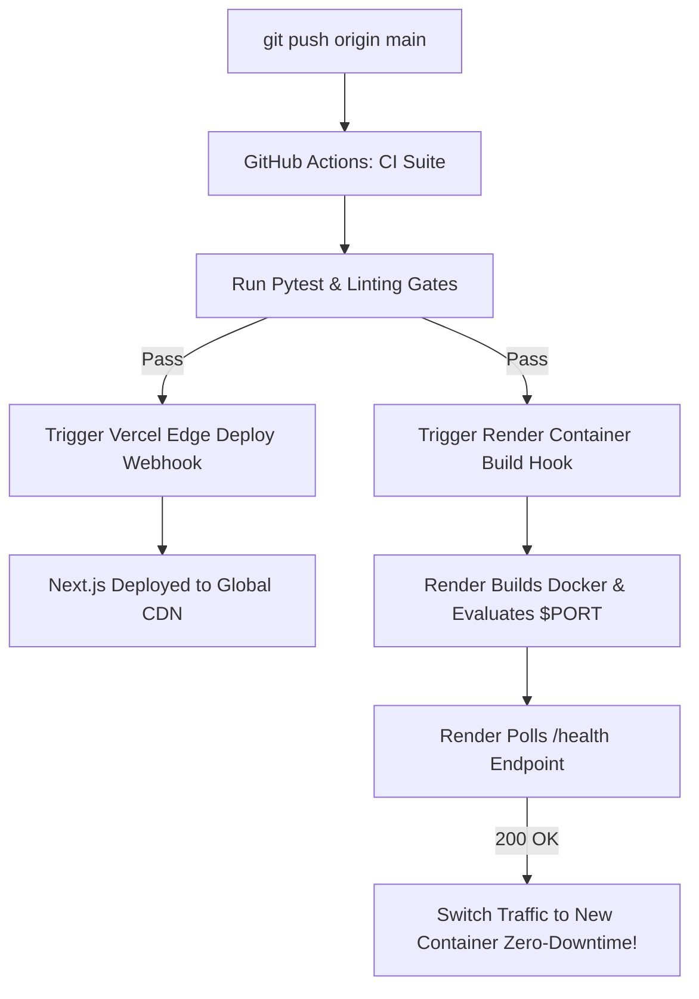

# Phase 9 — DevOps & Infrastructure Engineering
## System: FrameUp (DevFrames Enterprise MSME Operating System)

> **Architect's Orientation:** This document details **everything required to take FrameUp from a development workstation to global edge production**. We cover Git governance, multi-stage Docker containerization, dynamic port binding, continuous deployment pipelines, edge DNS routing, and runtime secret configuration.

---

## 61. Version Control & Trunk-Based Development
- **Branching Model:** Trunk-Based Development. Commits merged to `main` trigger automated deployments. Short-lived feature branches (`feature/<ticket>-<slug>`) exist for $<48\text{ hours}$.
- **Conventional Commits:** Enforces types: `feat`, `fix`, `perf`, `sec`, `refactor`, `test`, `docs`.

---

## 62. Build Engineering & Toolchains
- **Frontend Build:** Next.js compiler utilizing SWC (Speedy Web Compiler) for sub-second hot module replacement (HMR) and static route pre-rendering.
- **Backend Build:** Python virtual environment with frozen `requirements.txt` compiled into isolated runtime binaries.

---

## 63. Containerization: The Production Dockerfile

A lightweight multi-stage Docker build that reduces image weight from 1.5GB to **under 120MB**:

```dockerfile
# STAGE 1: Compilation Builder
FROM python:3.11-slim AS builder

WORKDIR /app

RUN apt-get update && apt-get install -y --no-install-recommends \
    build-essential \
    curl \
    && rm -rf /var/lib/apt/lists/*

COPY requirements.txt .
RUN python -m venv /opt/venv && \
    /opt/venv/bin/pip install --no-cache-dir --upgrade pip && \
    /opt/venv/bin/pip install --no-cache-dir -r requirements.txt

# STAGE 2: Minimalist Runner
FROM python:3.11-slim AS runner

WORKDIR /app

COPY --from=builder /opt/venv /opt/venv
ENV PATH="/opt/venv/bin:$PATH"

ENV PYTHONUNBUFFERED=1 \
    PYTHONDONTWRITEBYTECODE=1 \
    PORT=8000

COPY . .

# Run as non-privileged unprivileged user
RUN useradd -m -u 1001 appuser && chown -R appuser:appuser /app
USER appuser

# Health probe
HEALTHCHECK --interval=30s --timeout=5s --start-period=5s --retries=3 \
  CMD curl -f http://localhost:${PORT}/health || exit 1

EXPOSE 8000

# DYNAMIC PORT EVALUATION FOR RENDER CONTAINER
CMD ["sh", "-c", "python -m uvicorn app.main:app --host 0.0.0.0 --port ${PORT:-8000}"]
```

---

## 64. CI/CD Pipeline Automation



---

## 65. Cloud Architecture & Resource Footprint
- **Compute:** Render Linux ASGI container (512MB RAM, shared vCPU tier).
- **Edge Network:** Vercel Global Edge Network across 300+ PoPs worldwide.
- **Managed Database:** MongoDB Atlas M0/M10 replica set in AWS Mumbai (`ap-south-1`).
- **AI Hardware:** Groq Cloud LPU Tensor Streaming Cluster.

---

## 66. Infrastructure as Code (IaC) & Render Blueprints
Infrastructure configuration is version-controlled via `render.yaml`:
```yaml
services:
  - type: web
    name: devframes-backend
    env: python
    buildCommand: pip install -r requirements.txt
    startCommand: python -m uvicorn app.main:app --host 0.0.0.0 --port $PORT
    envVars:
      - key: PYTHON_VERSION
        value: 3.11.9
```

---

## 67. Deployment Engineering & Dynamic Port Binding

### The Render `$PORT` Bug Solution:
Render dynamically assigns an ephemeral host port (e.g. `10000`) and injects it via `$PORT`. Hardcoding `--port 8000` causes container termination. Our startup command evaluates `${PORT:-8000}` dynamically, guaranteeing flawless container boot in any environment.

---

## 68. Orchestration & Auto-Recovery
- Container restarts automatically upon uncaught segfaults or memory threshold triggers.
- Database connections use non-blocking connection pools that reconnect automatically (`retryWrites=true`).

---

## 69. Networking, Reverse Proxies & Edge DNS
- **Wildcard Edge DNS:** `*.frameup.in` routes to Vercel's Anycast IP addresses.
- **Edge Subdomain Rewriting:** `frontend/middleware.ts` rewrites `Host: <slug>.frameup.in` internally to `/site/<slug>` with zero DNS propagation delays.
- **TLS Termination:** Automated wildcard SSL via Let's Encrypt managed by Vercel and Cloudflare.

---

## 70. Configuration & Secrets Management

```
+---------------------+-------------------+------------------------------------------+
| Secret Key          | Environment       | Purpose                                  |
+---------------------+-------------------+------------------------------------------+
| MONGODB_URI         | Backend (Secret)  | Encrypted TLS MongoDB replica set URI    |
| JWT_SECRET          | Backend (Secret)  | 256-bit entropy signing key for HS256    |
| GROQ_API_KEY        | Backend (Secret)  | Authentication key for Groq LPU cluster  |
| NEXT_PUBLIC_API_URL | Frontend (Public) | Canonical backend origin API URL         |
| NEXT_PUBLIC_APP_URL | Frontend (Public) | Canonical web domain URL                 |
+---------------------+-------------------+------------------------------------------+
```
