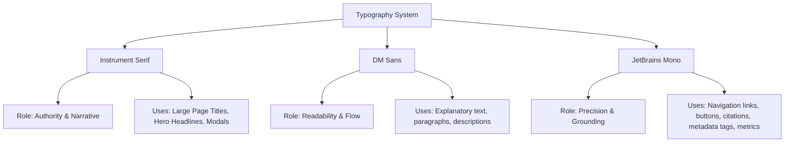
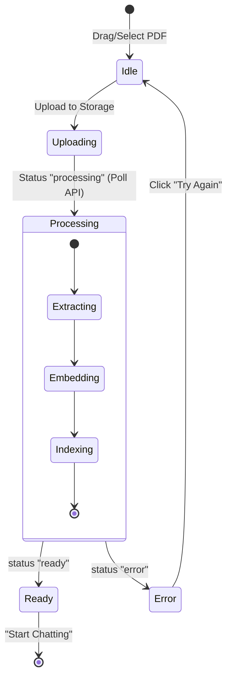

# High-Fidelity Frontend, UI & UX Blueprint
## *Design System, Layout Architecture, and Interaction Flow Patterns*

This document provides a comprehensive technical teardown of the **IDRS (Institute Document Retrieval System)** design language and user experience framework. It is structured to serve as an exact implementation reference and style guide for porting this aesthetic to other software products.

---

## 1. Core Design Philosophy
The design sits at the intersection of **Academic Authority** and **Technical Precision**. It avoids the playful, overly round characteristics of consumer SaaS apps in favor of a clean, structured, high-fidelity environment reminiscent of digital science journals and laboratory instruments.

### The Contrast Strategy
*   **The Editorial Voice:** Large, traditional serif headings suggest human study, wisdom, and rigorous documentation.
*   **The Technical Grounding:** Sharp monospace tags, code borders, and terminal-style metadata pills remind the user that the system is operated by high-precision, deterministic machine intelligence.

---

## 2. Global Design Tokens

### A. Color Palette
The colors are selected to support long-duration reading and clear status indication.

| Token | CSS Variable / Hex | Semantic Meaning | Recommended Usage |
| :--- | :--- | :--- | :--- |
| **Background** | `var(--background)` / `#F8FAFC` | Light Canvas Slate | Core screen wrapper, background color |
| **Surface** | `var(--surface)` / `#FFFFFF` | Pure White | Elevated card containers, modals, headers |
| **Surface High** | `var(--surface-high)` / `#F1F5F9` | Elevated Slate-100 | Hover backgrounds, input panels, list entries |
| **Border** | `var(--border)` / `rgba(226, 232, 240, 0.6)` | Slate-200 (60% Opacity) | Fine borders, divider lines |
| **Accent Primary**| `var(--accent)` / `#6366F1` | Lavender-Indigo | Action buttons, active statuses, primary highlights |
| **Success/Ready** | `var(--accent-success)` / `#10B981` | Sage-Mint | Verification labels, completed states, grounded badges |
| **Warning/Alert** | `var(--accent-warm)` / `#F59E0B` | Amber-Orange | Citation references, processing steps, unverified states |
| **Info/System** | `var(--accent-blue)` / `#3B82F6` | Sky-Blue | Diagnostic indicators, search types, system banners |
| **Text Primary** | `var(--text-primary)` / `#0F172A` | Deep Charcoal | Core headings, body paragraphs, interactive text |
| **Text Secondary**| `var(--text-secondary)`/ `#475569` | Slate-600 | Navigation items, descriptions, paragraph text |
| **Text Muted** | `var(--text-muted)` / `#64748B` | Slate-500 | Monospace metadata, helper descriptions, tooltips |

---

### B. Typography
The system uses three specific Google Fonts to divide roles clearly:



#### 1. Display Font: `Instrument Serif`
*   **Weights:** `400`
*   **Usage:** Elegant, high-impact headings. Styled with ultra-tight line spacing to create a compact, modern-editorial block of text.
*   **CSS Example:**
    ```css
    font-family: var(--font-instrument-serif), serif;
    line-height: 0.9;
    letter-spacing: -0.02em;
    ```

#### 2. Sans-Serif Font: `DM Sans`
*   **Weights:** `400`, `500`, `600`
*   **Usage:** User input text, chat bubbles, descriptions, tables, and lists.
*   **CSS Example:**
    ```css
    font-family: var(--font-dm-sans), sans-serif;
    line-height: 1.625; /* relaxed reading */
    ```

#### 3. Monospace Font: `JetBrains Mono`
*   **Weights:** `400`, `500`, `700`
*   **Usage:** Text elements that represent data outputs, metadata identifiers, tags, buttons, actions, counters, and progress.
*   **CSS Example:**
    ```css
    font-family: var(--font-jetbrains-mono), monospace;
    letter-spacing: 0.05em;
    text-transform: uppercase;
    ```

---

### C. Spacing, Shapes & Elevation
*   **Borders:** Fixed at `1px` solid `rgba(226, 232, 240, 0.6)`. Separators are never heavy.
*   **Corner Radii:**
    *   `rounded-none` (0px) used exclusively for landing buttons and structural panels to convey a strict mechanical identity.
    *   `rounded-sm` (4px) used for small UI blocks, avatars, and inline status badges.
    *   `rounded-md` (6px) used for standard inputs and buttons.
    *   `rounded-lg` (8px) used for sub-panels, notifications, and card layouts.
    *   `rounded-xl` (12px) used for primary containers and dropzones.
*   **Shadows:** Low-opacity, soft elevations.
    *   `shadow-sm`: Used on normal cards (`0 1px 2px 0 rgba(0, 0, 0, 0.05)`).
    *   `shadow-md`: Used on active controls and primary elements.
    *   `shadow-2xl`: Used on floating dropdowns and panels.

---

## 3. Micro-Animations & Transitions

Animations are subtle and behave naturally. There are no bouncing animations or long delays.

### A. Core Keyframes (Tailwind Config)
```typescript
animation: {
    fadeUp: "fadeUp 0.4s cubic-bezier(0.16, 1, 0.3, 1) both",
    pulse: "pulse 2s ease-in-out infinite",
    shimmer: "shimmer 1.5s infinite",
},
keyframes: {
    fadeUp: {
        "0%": { opacity: "0", transform: "translateY(16px)" },
        "100%": { opacity: "1", transform: "translateY(0)" },
    },
    pulse: {
        "0%, 100%": { opacity: "1", transform: "scale(1)" },
        "50%": { opacity: "0.4", transform: "scale(0.8)" },
    },
    shimmer: {
        "from": { backgroundPosition: "-200% 0" },
        "to": { backgroundPosition: "200% 0" },
    },
}
```

### B. Tactile Interactive States
*   **Button Hover Elevation:** Buttons with standard backgrounds transition slightly upward while expanding their shadow:
    `transition-all hover:-translate-y-0.5 hover:shadow-md`
*   **Dynamic Border Glow:** Cards transition their border color to matching accent elements on hover, signaling clickability:
    `transition-colors duration-200 hover:border-accent/50`

---

## 4. UI Components Architecture

### A. Semantic Buttons

```css
/* Base styles applied to all buttons: */
.btn-base {
    display: inline-flex;
    align-items: center;
    justify-content: center;
    white-space: nowrap;
    font-family: var(--font-jetbrains-mono), monospace;
    font-size: 0.875rem;
    text-transform: uppercase;
    letter-spacing: 0.05em;
    transition: all 0.2s cubic-bezier(0.16, 1, 0.3, 1);
}
```

1.  **Primary Button:** Accent background with solid contrasting text (black/white depending on contrast needs), low elevation, and immediate scaling responsiveness.
    *   *Tailwind:* `bg-accent text-black hover:brightness-110 shadow-md`
2.  **Default / Outline Button:** Soft white background with structured borders. Transitions to active text colors on focus.
    *   *Tailwind:* `bg-surface text-text-primary border border-border hover:border-text-secondary hover:-translate-y-0.5 shadow-sm`
3.  **Ghost Button:** Transparent background, highlighted border outline. Perfect for low-priority tools or toggles.
    *   *Tailwind:* `bg-transparent text-accent border border-accent/20 hover:bg-accent/10 hover:border-accent`
4.  **Danger Button:** Red outline that transitions into a warning visual box on hover.
    *   *Tailwind:* `bg-transparent text-red-500 border border-red-500/20 hover:bg-red-500/10 hover:border-red-500`

---

### B. Live Status Badges
Status indicators use matching colored text, light opacity backgrounds, and a pulsing status dot.

```tsx
export function Badge({ variant, children }) {
    const styles = {
        ready: "bg-emerald-50 text-emerald-700 border-emerald-200/50",
        processing: "bg-amber-50 text-amber-700 border-amber-200/50",
        error: "bg-red-50 text-red-700 border-red-200/50",
    };

    return (
        <div className={`inline-flex items-center border px-2.5 py-0.5 text-xs font-mono uppercase ${styles[variant]}`}>
            {/* Pulsing indicator dot */}
            {variant === "ready" && (
                <span className="mr-2 h-1.5 w-1.5 rounded-full bg-emerald-500 animate-pulse" />
            )}
            {variant === "processing" && (
                <span className="mr-2 h-1.5 w-1.5 rounded-full bg-amber-500 animate-pulse" />
            )}
            {children}
        </div>
    );
}
```

---

### C. The Interactive Upload Dropzone
The dropzone guides the user through the background pipeline steps (Upload $\rightarrow$ Extract $\rightarrow$ Embed $\rightarrow$ Index).



#### Key UX Features:
*   **Step-by-Step Progress Tracking:** Rather than a simple spinning wheel, the layout lists four tasks:
    1.  *Uploading to secure storage...*
    2.  *Extracting text content...*
    3.  *Generating vector embeddings...*
    4.  *Indexing for semantic search...*
*   As the backend processes, indicators turn green (`text-accent` and checkmarks), giving the user visual confirmation of progress.
*   **Error Detail Dialog:** On failure, a diagnostic error alert shows the exact server reason for failure, offering a quick option to retry.

---

### D. Custom Inline Citation Badge
Citations within text use a distinct visual design:

```tsx
export function Citation({ page, onClick }) {
    return (
        <span 
            onClick={onClick}
            className="text-xs bg-amber-500/10 text-amber-500 border border-amber-500/20 px-1.5 py-0.5 rounded cursor-pointer hover:bg-amber-500/20 transition-colors font-mono"
        >
            [p.{page}]
        </span>
    );
}
```

---

### E. Custom High-Fidelity Markdown Renderer
Standard Markdown containers can look blocky and generic. The app uses a custom parser to structure LLM text answers elegantly:
*   **Paragraphs:** Clean spacing with readable paragraph sizing (`text-sm leading-relaxed text-slate-800 font-sans`).
*   **Structured Tables:** Formatted with a clean gray header, thin grid separators, and alternate row highlighting.
    ```css
    table { min-width: 100%; divide-y: 1px divide-slate-200; font-size: 12px; }
    th { font-family: var(--font-jetbrains-mono); font-size: 10px; color: var(--text-muted); text-transform: uppercase; }
    td { padding: 8px 12px; }
    tr:hover { background-color: rgba(241, 245, 249, 0.5); }
    ```
*   **Inline Code Codeblocks:** Styled in red characters on a subtle gray canvas backdrop to prevent them from blending into body text:
    `px-1.5 py-0.5 bg-slate-100 border border-slate-200 text-red-600 font-mono text-xs rounded`

---

## 5. Layout and Navigation Patterns

### A. The Dashboard Layout
*   **Persistent Navigation Sidebar (240px wide):** Contains layout navigators, workspace profiles, and a visual storage quota usage gauge.
*   **Floating Blur Header (60px high):** Stays fixed at the top with a subtle backdrop filter (`bg-background/50 backdrop-blur-sm`). Houses the global search input and user utility dropdowns.

```
+-------------------------------------------------------------+
| IDRS         |  Search all documents...   [cmd+k]  [Bell] []|  <-- Topbar (60px, Fixed)
+--------------+----------------------------------------------+
| [DASHBOARD]  |                                              |
| [DOCUMENTS]  |                                              |
| [PROJECTS]   |                                              |
| [ANALYTICS]  |                   MAIN CONTENT               |
| [SETTINGS]   |                      AREA                    |
|              |                                              |
|              |                                              |
| STORAGE [|||]|                                              |
| User profile |                                              |
+--------------+----------------------------------------------+
  ^ Sidebar (240px)
```

---

### B. Multi-Panel Chat Layout (The 4-Panel Grid)
Designed to handle intensive data comparison tasks side-by-side.

```
+--------------+-----------------------+--------------+-------+
|  Document    |                       |  Document    | Cite  |
|  Sidebar     |    Chat Interface     |  Metadata &  | Panel |
|              |                       |  Insights    |       |
|  (Lists PDF  |  (Main chat stream)   |              | (Pops |
|   files)     |                       | (Outlines,   |  out) |
|              |                       |  anomalies,  |       |
|              |                       |  suggested   | (Show |
|              |                       |  questions)  | cited |
|              |                       |              | text) |
+--------------+-----------------------+--------------+-------+
  (280px)               (Flex-1)            (340px)    (300px)
```

*   **Responsive Collapsing:** Panels adjust dynamically. On narrower screens, the left document list and right insights panels collapse automatically to keep the chat interface usable.
*   **Animated Slide-out Citation Drawer (SourcePanel):** Clicking a citation badge (`[p.4]`) slides out a drawer (`300px` wide) from the right with a smooth ease-in animation, loading the exact source page snippet to verify the answer instantly.

---

## 6. Key UX Workflows & Logic

### A. Document Processing Polling
To avoid page freezes during heavy document indexing, the grid uses dynamic background queries:
1.  On mounting, the application fetches the initial document list.
2.  If any document has a status of `"processing"`, the page starts a background timer to check for updates every 5 seconds.
3.  Once the status changes to `"ready"` or `"error"`, the timer stops and the UI updates cleanly.

```typescript
useEffect(() => {
    const hasProcessing = documents.some(doc => doc.status === 'processing');

    if (hasProcessing) {
        const interval = setInterval(() => {
            fetchDocs(false); // background update, hides standard loading spinners
        }, 5000);
        return () => clearInterval(interval);
    }
}, [documents]);
```

---

### B. User Onboarding Setup Flow
Instead of dropping users directly into an empty dashboard, the app uses a step-by-step onboarding process:
1.  **Value Presentation:** Explains the system's "Grounded Intelligence" model.
2.  **Upload Action:** Prompts the user to drag and drop their first document.
3.  **Interactive Preview:** Displays a split interface showing the document chat. This lets the user test the system with sample queries immediately, showing value before they configure any API parameters.

---

## 7. How to Apply This Design Style in New Projects

Follow these design principles when building another app in this style:

### 1. Configure the Typography Base
Use `Tailwind` configuration values or custom CSS variables to map font types to specific design duties:
```css
--font-display: 'Instrument Serif', serif;  /* Elegant headings, stats */
--font-sans: 'DM Sans', sans-serif;          /* Clean readability, inputs */
--font-mono: 'JetBrains Mono', monospace;    /* Labels, metadata, tags */
```

### 2. Implement the Design Language Rules
1.  **No Heavy Grids:** Use low-opacity border strokes (`rgba(226, 232, 240, 0.6)`) to separate sections.
2.  **Strict Color Roles:** Use gray backgrounds (`#F8FAFC`) with white cards (`#FFFFFF`). Limit accent colors to a primary indicator (`#6366F1`) and system states (Sage, Amber, Sky-Blue).
3.  **Monospace Metadata:** Render metadata, dates, labels, and numbers in monospace font (`JetBrains Mono`). Keep headers clean with serif typography.
4.  **Tactile hover states:** Apply shadow and position shifts when hover states are active.
5.  **Always cite sources:** Ground information with interactive tag panels, letting users inspect data changes on the fly.
